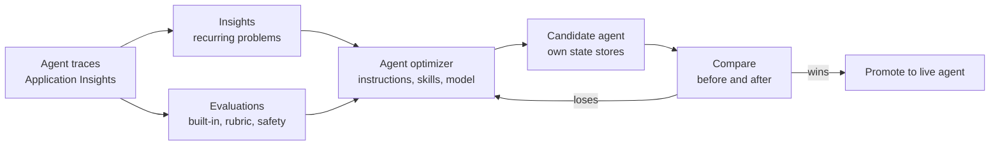

# Investment Advisor Agent with Microsoft IQ

A research agent for investment advisors that grounds every answer in all four **Microsoft IQ** sources. Before a
client meeting it pulls the client's story together from the advisor's Microsoft 365 work with **Work IQ**, confirms
the numbers against the portfolio system of record with **Fabric IQ**, applies the firm's own policies with
**Foundry IQ**, and adds public market context with **Web IQ**, behind a guard that keeps client data inside the
boundary. It remembers past conversations and runs long research in checkpointed waves in the **Foundry durable state
store**, asks before it drafts anything, and improves through Foundry's **quality loop**: Insights, evaluations and
the agent optimizer. It runs as a **Microsoft Foundry hosted agent** built on the **Microsoft Agent Framework** agent
harness.

> **Fictional data.** Every person, company, client, email, meeting, document, policy and number in this repository
> is fictional and for demo purposes only. Michael Scott, Contoso Wealth and the other names are invented for the
> story. Nothing here is investment, tax or legal advice.


## The problem

Before a client review, an advisor's facts are spread across many places: the client's emails, the recording and
notes of the last review, an analyst's alert, a chart on page 3 of a PDF in OneDrive, the signed investment policy
statement (IPS) and an unsigned draft in SharePoint, the positions in the portfolio system, the firm's policies, and
the news. Each source is only partly right, some disagree, and some are already out of date. The agent assembles them
into one brief, cites every fact with the IQ it came from, flags what disagrees, and says what it could not verify.

## Microsoft IQ in one agent

| IQ | What it knows | How the agent reaches it | Runs as |
|---|---|---|---|
| **Work IQ** | The advisor's email, calendar, meetings and transcripts, Teams chats, OneDrive and SharePoint files | Foundry Toolbox: Work IQ **MCP** tools (`retrieve`, `fetch`, `ask`, discovery, `list_agents`) and Work IQ **Chat over A2A** | The signed-in advisor (one-time OAuth consent), under the tenant's Work IQ policy |
| **Fabric IQ** | The portfolio system of record: positions, weights against limits, cash | The Fabric data agent ("Portfolio Analyst") over MCP | The signed-in advisor (OAuth), with their Fabric permissions |
| **Foundry IQ** | The firm's policies, procedures, approved products and house view | An Azure AI Search knowledge base (agentic retrieval) over MCP | The Foundry project's managed identity |
| **Web IQ** | Public news, web pages and market quotes | Web IQ over MCP (API key), optional | A key; outside the Microsoft 365 and Azure boundary, so a guard blocks client names, amounts, account numbers and tenant links before anything is sent |

## What it does

The demo follows one advisor through one week with the fictional client Michael Scott: a recorded quarterly review on
Friday, emails over the weekend, an analyst's alert on Monday, the demo on Tuesday or Wednesday, and the client
meeting on Thursday.

| Ask the agent | What it does | Built with |
|---|---|---|
| *Prepare me for Thursday's meeting with Michael Scott.* | A one-page brief: snapshot, what changed, risks and the firm rules they trigger, questions to ask, sources grouped by IQ | All four IQs in one parallel step; exact arithmetic tools; `client-meeting-prep` skill |
| *Michael wants to wire $400,000 to his title company. What does our policy require?* | The firm's rule, cited by document and section | Foundry IQ knowledge base |
| *What is the public news on NVIDIA this week?* | Three items with publisher, date and link; never reprices the client's position | Web IQ with the boundary guard |
| *Search the web for Michael Scott's NVDA position.* | Refuses; the guard would block the query before it leaves | Boundary guard (`WEB_QUERY_BLOCKED`) |
| *Compare Michael's signed IPS with the v2 draft.* | A term-by-term table and which version is in force | Work IQ `ask` with `fileUrls`: Copilot reasons over exactly those two files |
| *Delegate to Work IQ: what did Michael ask me for, and what is still open?* | Work IQ's own finished answer with links, as an A2A task | Work IQ Chat over A2A (`delegate_to_work_iq`) |
| *Which Copilot agents can you work with?* | The Microsoft and organization agents the advisor can reach, and asking one of them | Work IQ `list_agents` and `ask` with `agentId` |
| *What exactly did Michael say about his tax budget?* | Verbatim transcript quotes and action items | Work IQ over meetings and transcripts |
| *Find the chart of his NVDA weight. What were the high and the low?* | Finds the PDF, verifies the page, reads the chart image | Work IQ `ask`; `inspect_document`; `read_chart` fallback |
| *Run a durable meeting pack for Michael Scott* (with the crash test armed) | Stops the process between writes, then resumes in another process without repeating a finished phase | Foundry durable state store: checkpoints, progress marker with ETag, timeline |
| *Draft a reply to Michael.* | Asks for approval, then creates a draft only; tenant policy blocks updates and deletes | Approval step in the harness; Work IQ `create_entity`; policy probe |
| The analyst asks the same question | Sees only what the analyst may see | Work IQ and Fabric IQ run as the signed-in user |

## Work IQ three ways: MCP, A2A and Copilot agents

- **MCP (tools):** the agent composes Work IQ's tools step by step: semantic `retrieve` with citations, direct
  Microsoft Graph reads with `fetch`, runtime discovery with `search_paths` and `get_schema`, Copilot reasoning with
  `ask`, and governed writes such as an approval-gated draft.
- **A2A (chat):** the agent hands a whole question to Work IQ's own agent and gets back a finished answer as an A2A
  task. Through the Foundry toolbox each message is a new task, so follow-ups go through `ask`, which keeps one
  conversation per agent.
- **Copilot agents:** `list_agents` returns the Microsoft and organization agents the advisor can use, and `ask` with
  their `agentId` delegates to them.

Every call runs as the signed-in advisor, and the tenant's Work IQ policy evaluates each one. Work IQ workspaces
(SharePoint Embedded working storage) have no public API yet, so this sample keeps durable state in the Foundry state
store instead.

## Durable by design

Long research runs in waves: Work IQ documents and meetings, then calendar and email, then Fabric IQ, Foundry IQ and
Web IQ. Following Foundry's guidance for long-running agents, each finished phase is written as an append-only
checkpoint (a deterministic key and a SHA-256) **before** the progress marker moves, and the marker moves only with
the ETag of the last read. The crash test stops the agent process exactly between those writes. The next attempt, in
any process or session, restores what the marker passed, verifies and reuses the checkpoints written just before the
stop, runs only what is missing, and shows a timeline of every attempt, process and store write.

## The quality loop: observe, evaluate, optimize



Instructions, skills and the model live in [`.agent_configs/baseline`](.agent_configs/baseline), the format the
Foundry agent optimizer reads and writes. [`evals/Invoke-QualityLoop.ps1`](evals/Invoke-QualityLoop.ps1) runs the
loop on a candidate agent next to the live one, so nothing changes for users until a candidate wins, and a leakage
guard refuses optimizer candidates that memorize the test set (absolute dates, test answers, staff names). See
[docs/QUALITY-LOOP.md](docs/QUALITY-LOOP.md).

## Architecture in brief

- **Agent:** a Foundry hosted agent (Python 3.14, Microsoft Agent Framework 1.22 harness,
  `agent-framework-foundry-hosting`), image in Azure Container Registry, model `gpt-5.6-luna`.
- **Tools through Foundry Toolbox:** Work IQ MCP and Work IQ Chat (A2A) with per-user OAuth, the Fabric IQ data agent
  with per-user OAuth, the Foundry IQ knowledge base with the project's managed identity, Web IQ with an API key, an
  approval-gated drafts toolbox and a governance probe.
- **Foundry IQ:** Azure AI Search (Basic, semantic ranker) with a hybrid text and vector index
  (`text-embedding-3-large`), a knowledge source and a knowledge base; the firm library is pushed into the index, so
  no storage account is needed.
- **State:** the Foundry durable state store for memory, preferences, conversation history and research checkpoints;
  Azure Cosmos DB for the chat UI's session list.
- **Chat UI:** a React app on Azure Container Apps with Microsoft Entra sign-in; an X-ray panel shows every tool call
  and which IQ answered.
- **Observability and quality:** OpenTelemetry traces in Application Insights (and Agent 365 observability where the
  tenant has it), Foundry evaluations, Insights and the agent optimizer (`gpt-5.5` judges and proposes; `gpt-6-sol`
  is a model-search candidate).
- **Infrastructure:** Terraform (azurerm, azapi, azuread) and PowerShell 7 scripts.

Details: [docs/ARCHITECTURE.md](docs/ARCHITECTURE.md) and [docs/TECHNICAL-GUIDE.md](docs/TECHNICAL-GUIDE.md).

## Deploy it to your tenant

You need a Microsoft 365 tenant with two users (you, the tenant admin, are the advisor; a second licensed user is
the analyst), an Azure subscription with model quota, Work IQ API usage-based billing, optionally a Web IQ API key,
and a Windows machine with PowerShell 7, Azure CLI, Python and Node.js. Then:

```powershell
git clone https://github.com/dhangerkapil/investment-advisor-agent-microsoft-iq.git
cd investment-advisor-agent-microsoft-iq
.\scripts\Deploy-AdvisorDemo.ps1 -TenantId <tenant guid> -SubscriptionId <subscription guid> `
    -ResourceGroup rg-investment-advisor -AnalystUpn analyst@contoso.com `
    -WebIqApiKey (Read-Host 'Web IQ API key (Enter to skip Web IQ)' -AsSecureString)
```

The script deploys the platform, the Work IQ connection and toolboxes, the Fabric portfolio data, the Foundry IQ firm
library and knowledge base, Web IQ (when you give a key), the agent, the UI, the quality assets and the Microsoft 365
demo content, then prints the few steps that need a person (Work IQ policy, consent, recording one short Teams
meeting). It creates every service from scratch, including the Foundry account with its models and the Fabric
capacity; to reuse a Foundry account and a Fabric capacity you already have (for example in a shared resource group),
add `-ExistingFoundryAccountId` and `-ExistingFabricCapacityId`. If Azure AI Search has no capacity in your region,
add `-SearchLocation <region>`. The story's dates follow
`-StoryMeetingDate` (default: the next Thursday), so the demo works in any week. Full guide:
[docs/DEPLOYMENT.md](docs/DEPLOYMENT.md). Demo script: [docs/DEMO-SCRIPT.md](docs/DEMO-SCRIPT.md).

**Cost:** model tokens, the Fabric capacity while it runs (pause it with
`.\scripts\Set-FabricCapacityState.ps1 -State Paused`), Azure AI Search (Basic), Container Apps, Cosmos DB, the
registry, Work IQ API Copilot Credits and Web IQ usage. **Remove everything:** `.\scripts\Remove-AdvisorDemo.ps1`.

## Repository map

| Path | Contents |
|---|---|
| [`src/workplace_agent`](src/workplace_agent) | The hosted agent: harness setup, the four IQ tools, the Web IQ boundary guard, durable state, approvals, evidence checks |
| [`.agent_configs/baseline`](.agent_configs/baseline) | Instructions, skills and model (optimizer format) |
| [`ui`](ui) | The chat UI (React, Vite) and its API |
| [`terraform`](terraform) | Azure and Entra resources, including Azure AI Search for Foundry IQ |
| [`scripts`](scripts) | Deployment, Foundry IQ and Web IQ setup, release, rehearsal, candidate and teardown scripts (PowerShell 7) |
| [`evals`](evals) | Evaluations, Insights, agent optimizer and the quality loop |
| [`hydration`](hydration) | The fictional story: mail, calendar, documents, PDFs, the firm library, meeting script |
| [`fabric`](fabric) | The fictional portfolio lakehouse and the Portfolio Analyst data agent |
| [`tests`](tests) | Unit and deployment tests |
| [`docs`](docs) | Architecture, deployment, quality loop, demo script, technical guide |

## Support, security and license

This is a sample, not a supported product: see [SUPPORT.md](SUPPORT.md) and [SECURITY.md](SECURITY.md). Licensed
under the [MIT License](LICENSE).
