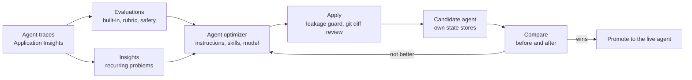

# Architecture: Investment Advisor Agent with Microsoft IQ

A research agent for investment advisors that runs as a **Microsoft Foundry hosted agent** on the **Microsoft Agent
Framework** harness and grounds every answer in the four **Microsoft IQ** sources: Work IQ, Fabric IQ, Foundry IQ and
Web IQ. This page is the short overview; the detailed design is in the
[solution specification](architecture/investment-advisor-agent-microsoft-iq_solution_spec.md) and the
[technical architecture](architecture/investment-advisor-agent-microsoft-iq_technical_architecture.md).

> **Fictional data.** Contoso Wealth, the client Michael Scott and every person, email, document, policy and figure in
> this sample are fictional. Nothing here is investment, tax or legal advice.

Editable source: [investment-advisor-agent-microsoft-iq.drawio](architecture/investment-advisor-agent-microsoft-iq.drawio)
(also as [SVG](architecture/investment-advisor-agent-microsoft-iq.svg)). The numbers in the diagram match its legend.

## Components

| Component | What it does | Runs on |
|---|---|---|
| Chat UI | React app with Microsoft Entra sign-in (MSAL), sessions, an activity panel of every tool call, Approve and Reject for drafts, Authorize links for consent, a source viewer | Browser, served by the chat UI API |
| Chat UI API | Validates the user's token, exchanges it on behalf of the user (no client secret: a managed-identity federated credential), streams the agent, keeps the session list | Azure Container Apps (VNet-injected), Azure Cosmos DB through a private endpoint |
| Investment advisor agent | Agent Framework harness with 15 skills, the four IQ tools, exact arithmetic and time tools, memory, the durable meeting pack, approvals and an evidence loop; model `gpt-5.6-luna` | Foundry hosted agent (Python 3.14 container from Azure Container Registry) |
| Foundry Toolbox | Seven toolboxes, one MCP endpoint each, that hold the connection and credential for each source and forward the caller's context | Foundry project |
| Durable state store | User-isolated memory, preferences, conversation history, meeting-pack checkpoints and pending approvals | Foundry (preview) |
| Quality services | Evaluations, a rubric evaluator, Insights, the agent optimizer and a candidate agent | Foundry project, traces in Application Insights |
| Platform | Container Registry, Cosmos DB, Application Insights, Azure AI Search, Fabric capacity | One resource group (Terraform and PowerShell 7) |

## The four Microsoft IQ sources

| IQ | What it knows | How the agent reaches it | Runs as | Boundary |
|---|---|---|---|---|
| **Work IQ** | The advisor's email, calendar, meetings and transcripts, Teams chats, OneDrive and SharePoint files, and the Copilot agents the advisor can use | Work IQ **MCP** tools (`retrieve`, `fetch`, `ask`, discovery, `list_agents`), Work IQ **Chat over A2A** (one A2A task per call; follow-ups use `ask`), **Copilot agents** through `ask` with `agentId` | The signed-in user (one-time OAuth consent per user and agent), under the tenant's Work IQ policy | Inside Microsoft 365 |
| **Fabric IQ** | The portfolio system of record: positions, weights against limits, cash, the IPS record (synthetic lakehouse) | The Fabric data agent "Portfolio Analyst" over MCP | The signed-in user (OAuth), with their Fabric permissions | Inside Microsoft Fabric |
| **Foundry IQ** | The firm's policies, procedures, approved products and house view (six fictional documents) | The `firm-knowledge` knowledge base in Azure AI Search (agentic retrieval, hybrid text and vector search) over MCP | The Foundry project's managed identity | Inside Azure |
| **Web IQ** (optional, preview) | Public news, web pages and market quotes | Web IQ over MCP | An API key | **Outside** the Microsoft 365 and Azure compliance boundary: a `BoundaryGuard` in the agent blocks client and staff names, email addresses, amounts, account-like numbers and tenant links before anything is sent |

## Main flows

1. **Sign-in and chat.** The advisor (or the analyst) signs in; the browser calls the chat UI API, which calls the
   hosted agent's Responses endpoint on behalf of the user and streams the answer back.
2. **Meeting preparation.** One parallel step reads client memory and calls Work IQ (Graph reads with `fetch`,
   semantic `retrieve`), Foundry IQ and Fabric IQ together. Then Web IQ adds public news behind the guard, and exact
   tools compute trims, tax budgets, liquidity and Eastern time. The agent compares the sources, flags conflicts,
   saves the brief with `record_brief` and answers with sources grouped by IQ.
3. **Delegation.** "Delegate to Work IQ" sends a whole question to Work IQ's own agent over A2A. Copilot agents,
   Microsoft agents (for example Planner) and the organization's own agents, are found with `list_agents` and asked
   with `ask` and `agentId`.
4. **The only write.** A follow-up email is proposed, the advisor approves it in the UI, and Work IQ `create_entity`
   saves it in Outlook Drafts. Nothing is sent; the tenant's Work IQ policy denies updates and deletes.
5. **Sources.** The UI's source viewer opens cited emails, events, chats and files through Microsoft Graph as the
   user.

## Durability

The agent keeps memory, preferences, conversation history and research state in the Foundry durable state store,
isolated per user, so any process or session can continue a conversation. Long research runs as the **durable
meeting pack** in three waves (Work IQ documents and meetings; Work IQ calendar and email; Fabric IQ, Foundry IQ and
Web IQ). Following Foundry's guidance for long-running agents, each finished phase is an append-only checkpoint
(`create_item`, a deterministic key and a SHA-256) written **before** the progress marker moves, and the marker moves
only with the ETag of the last read (`set_item` with `if_match`). The crash test stops the process between those two
writes; asking again from another session or process restores what the marker passed, verifies and reuses the
checkpoints written just before the stop, and runs only what is missing.

What this sample does not claim: the agent resumes when asked. Automatic re-entry by the platform (resilient
background responses) is supported for workflow agents, not for this chat agent. Work IQ workspaces have no public API
yet, so durable state lives in the Foundry state store.

## Quality loop

Instructions, skills and the model live in `.agent_configs/baseline`, the format the Foundry agent optimizer reads
and writes. Changes are evaluated on a candidate agent next to the live one, and `apply` refuses candidates that
memorize the test set (absolute dates, test answers, staff names). See [QUALITY-LOOP.md](QUALITY-LOOP.md).

## Security

- **Identity per source:** Work IQ and Fabric IQ run as the signed-in user, so the analyst sees only the analyst's
  data; Foundry IQ runs as the project's managed identity; Web IQ uses an API key; the hosted agent calls models,
  toolboxes and the state store as its own agent identity with the caller's context.
- **Least privilege:** every Azure role assignment comes from Terraform and is listed in the
  [technical architecture](architecture/investment-advisor-agent-microsoft-iq_technical_architecture.md#azure-rbac-role-assignments-from-terraform);
  Azure services use Entra authentication only (no keys).
- **Boundary and writes:** the `BoundaryGuard` keeps client data out of Web IQ; the draft tool needs the advisor's
  approval on every call; the Work IQ tenant policy allows create and denies directory lookups, update, replace and
  delete; content-safety filters block harmful prompts and completions.
- **Network:** the UI runs in a virtual network and reaches Cosmos DB through a private endpoint. The Foundry account
  keeps a public, Entra-only endpoint because OAuth tool connections are not supported on managed-network accounts.
- **Demo settings:** the deployment script records prompts and tool payloads in traces for synthetic demo tenants;
  turn this off (`agent_capture_content = false`) before any real data.

## Deployment options

`scripts/Deploy-AdvisorDemo.ps1` deploys everything with one command ([DEPLOYMENT.md](DEPLOYMENT.md)).

- **Create from scratch (default):** the Foundry account with its models (`gpt-5.6-luna`, `gpt-5.5`,
  `text-embedding-3-large`) and project, a Fabric capacity, Azure AI Search, Container Registry, Cosmos DB, Container
  Apps, Application Insights and the Entra app registrations.
- **Reuse an existing Foundry account** (`-ExistingFoundryAccountId`): the deployment creates only its own project and
  its own guardrail policy in that account and uses the account's existing model deployments `gpt-5.6-luna`,
  `gpt-5.5` and `text-embedding-3-large`.
- **Reuse an existing Fabric capacity** (`-ExistingFabricCapacityId`): the deployment creates its own workspace on that
  capacity.
- **Teardown** (`scripts/Remove-AdvisorDemo.ps1`) removes what the deployment created and never deletes a reused
  Foundry account or Fabric capacity: only its project, guardrail policy, role assignments and workspace are removed
  from them.

## Read more

- [Solution specification](architecture/investment-advisor-agent-microsoft-iq_solution_spec.md): scope, integration,
  data, security, risks.
- [Technical architecture](architecture/investment-advisor-agent-microsoft-iq_technical_architecture.md): agents,
  workflows, sequence diagrams, containers, identities and role assignments, deployment.
- [Technical guide](TECHNICAL-GUIDE.md), [deployment guide](DEPLOYMENT.md), [quality loop](QUALITY-LOOP.md),
  [README](../README.md).
