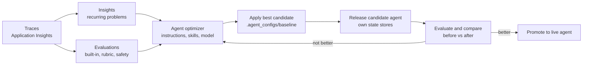

# The quality loop: Insights, evaluations and the agent optimizer

An agent that reads live, messy data drifts: a new kind of email, a changed document, a new model version. The
quality loop finds what goes wrong in real traffic, measures it, proposes a fix, proves the fix on a candidate agent,
and only then releases it. Everything runs in Microsoft Foundry, on the agent's own traces.



## The parts

| Part | What it does here | Where |
|---|---|---|
| **Traces** | Every turn: the model calls, tool calls (Work IQ, Fabric, harness tools) and results, stamped with the agent's `name:version` | Application Insights, via OpenTelemetry in `src/workplace_agent/app.py` |
| **Insights** | Scans recent traces with a judge model and groups failures into findings (for example "quotes not verbatim", "future-dated evidence"), each with evidence traces and a suggested fix. A monitor scans daily. | `evals/foundry_quality.py insights` |
| **Evaluations** | Scores saved demo turns with built-in judges (task adherence, task completion, intent resolution, groundedness, tool-use quality), the `advisor-harness-quality` rubric evaluator (generated from the agent's own instructions), and the indirect-attack (prompt-injection) judge | `evals/foundry_quality.py dataset` |
| **Agent optimizer** | Proposes and scores candidates for the hosted agent's **instructions**, **skills** and **model**, on the test cases in `evals/hosted-optimizer-cases.json`, with `gpt-5.5` writing candidates and judging | `evals/foundry_quality.py optimize-hosted` |
| **Candidate agent** | A second hosted agent with the same toolboxes and its own memory and checkpoint stores, so a candidate never touches the live agent's users or state | `scripts/Publish-CandidateAgent.ps1` |

## Why the agent is optimizer-ready

The agent's instructions, skills and model are data, not code: [`.agent_configs/baseline`](../.agent_configs/baseline)
holds `instructions.md`, `skills/<name>/SKILL.md` and `metadata.yaml` (the model). At startup
`src/workplace_agent/agent_config.py` calls `load_config()` from `azure-ai-agentserver-optimization`:

- In normal runs it loads `baseline`.
- When the optimizer runs a candidate, the platform passes the candidate's ID and a resolve endpoint; `load_config()`
  fetches that candidate's instructions, skills and model, so the same image runs every candidate.
- `apply` writes the winning candidate back into `baseline`, where you review it with `git diff` like any change.

## Guard against overfitting

The optimizer scores candidates on a small set of test cases, and a candidate can win by memorizing them. In this
project's first run, the best-scoring candidate hard-coded "the current date", copied figures from the test answers
into its instructions and greeted the advisor by name: a higher score that would have broken in any other week or
tenant. `apply` therefore checks every candidate before it writes anything and refuses one that:

- states an absolute date ("Current date is ...", "Today is ...");
- contains a figure, date or time from a test case's ground truth (`evals/hosted-optimizer-cases.json`,
  `evals/optimizer-cases.json`) that the current baseline does not already contain;
- names the advisor or the analyst when the baseline does not.

It prints why. Take the candidate's general improvements by hand, or, after review, apply it anyway with
`-AllowLeaks`. Either way, a candidate reaches users only after it wins on the candidate agent.

## Run the loop

Prerequisites: a deployed agent ([DEPLOYMENT.md](DEPLOYMENT.md)), the recorded review and the Monday stage, and Work
IQ consent for the candidate agent (the first call prints the link).

```powershell
# 1. Release a candidate next to the live agent (same code; own state stores), consent once, seed its memory.
.\evals\Invoke-QualityLoop.ps1 -Stage Release
.\scripts\Invoke-AdvisorAgent.ps1 -AgentName <candidate> -Prompt "Save Friday's Q4 portfolio review with Michael Scott as our last discussion."

# 2. Measure: rehearse the side-effect-free demo prompts, score them, scan the traces with Insights.
.\evals\Invoke-QualityLoop.ps1 -Stage Evaluate, Insights -Label before

# 3. Improve: the optimizer proposes instructions, skills and model; see the candidates and scores.
.\evals\Invoke-QualityLoop.ps1 -Stage Optimize
.\evals\Invoke-QualityLoop.ps1 -Stage Status

# 4. Apply the best candidate, review the diff, release it as the candidate agent.
.\evals\Invoke-QualityLoop.ps1 -Stage Apply
git diff -- .agent_configs
.\evals\Invoke-QualityLoop.ps1 -Stage Release

# 5. Verify: the same evaluation, compared with step 2.
.\evals\Invoke-QualityLoop.ps1 -Stage Evaluate, Compare -Label after -Before before

# 6. Promote when it wins (publishes the same code to the live agent); otherwise git checkout -- .agent_configs.
.\evals\Invoke-QualityLoop.ps1 -Stage Promote
```

The candidate's name is `ADVISOR_CANDIDATE_AGENT` from `.env.local`, else `<live agent>-candidate`. Each stage is a
thin wrapper; `evals\Invoke-FoundryQuality.ps1` runs the same commands one by one (`dataset`, `insights`,
`optimize-hosted`, `optimizer`, `apply`, `compare`).

## Model selection

The optimizer compares the agent's model with the deployments in Terraform's `model_search_deployments`. Add one in
`terraform/terraform.tfvars`, then rerun the Platform step:

```hcl
model_search_deployments = { "gpt-6-sol" = { version = "2026-09-22", capacity = 150 } }
```

A model change lands in `metadata.yaml`. Before promoting it, set `chat_model` in `terraform.tfvars` to the same
deployment, so the live agent's definition matches; `-Stage Promote` warns when they differ.

## Read the results

- **Compare** prints each judge's pass rate and the rubric mean before and after. A candidate should win on the
  rubric and on task adherence without losing groundedness or the indirect-attack judge.
- **Status** lists each candidate's score per test case. Look at the worst case, not just the average.
- **Insights** findings should disappear from later scans; open their evidence traces from the agent's Insights page
  in the Foundry portal.
- **Cost:** the optimizer prints an estimate before it starts (a few US dollars for six cases and three candidates,
  plus the agent's own model use).

## Automate it

- **Every pull request:** `.github/workflows/ci.yml` runs the unit tests, the story-date check, the UI tests and
  `terraform validate`.
- **Every day:** the Insights monitor scans the live agent's traces (`insights -ScheduleHours 24`, set by the
  Quality step of the deployment).
- **On demand:** the loop above. It runs as a person on purpose: the optimizer and the rehearsal call the agent as
  the signed-in user, so Work IQ reads that user's Microsoft 365 data with their consent.
