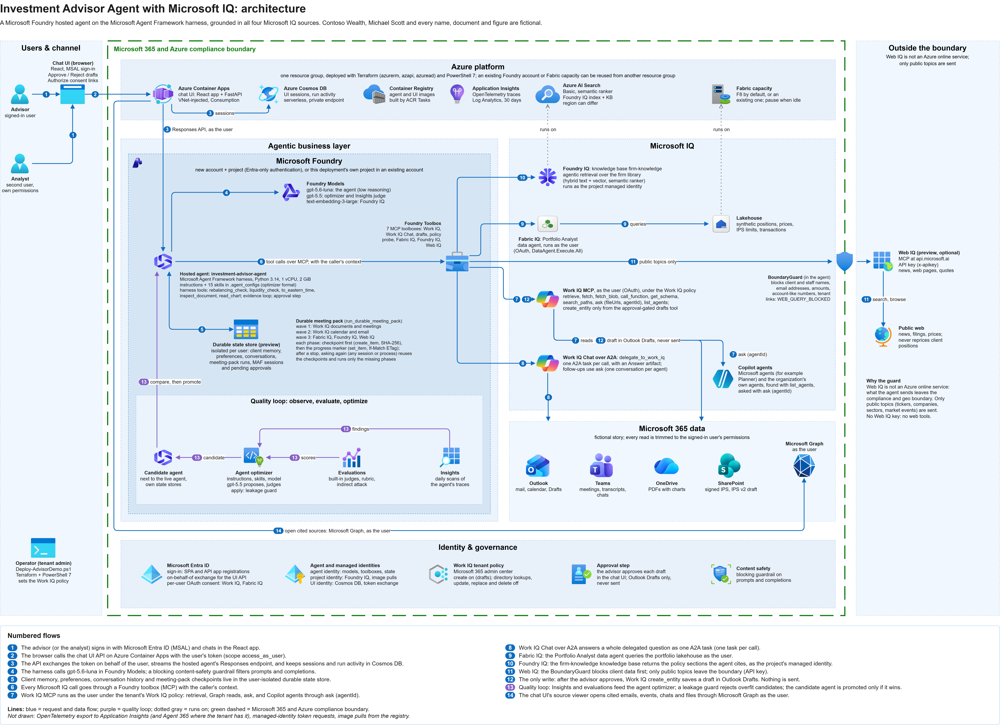
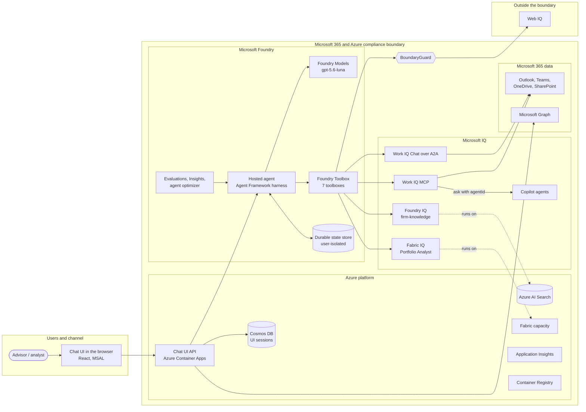
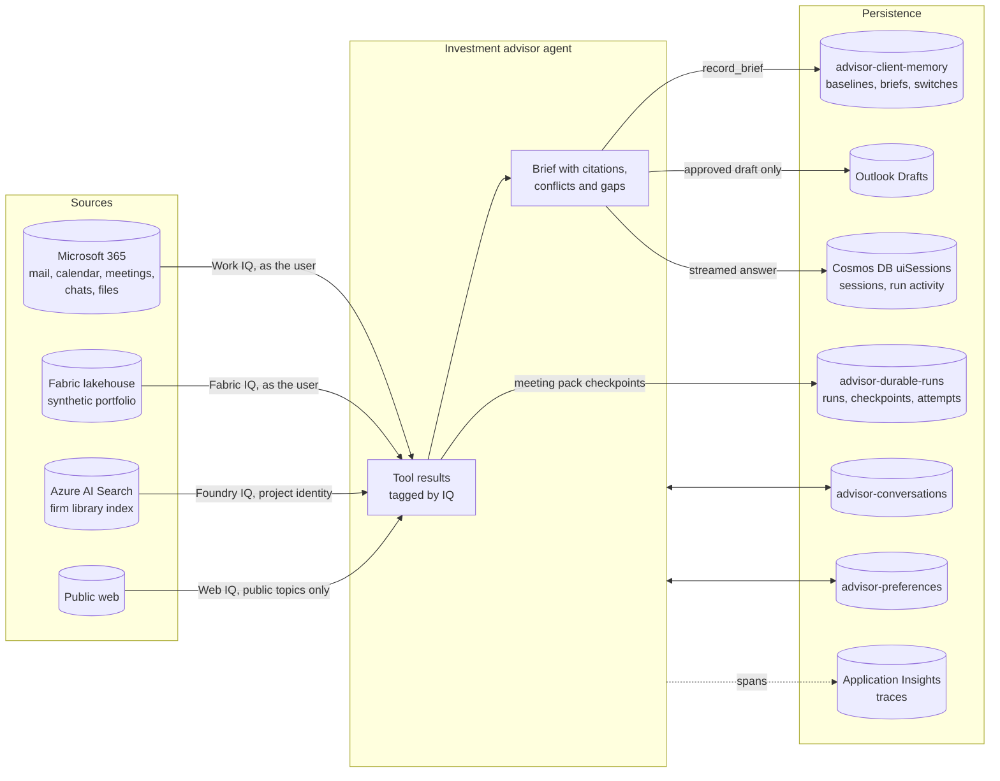

# Investment Advisor Agent with Microsoft IQ: Solution Specification

**Document Version:** 1.0  
**Date:** 2026-10-18  
**Author(s):** Factory Architect Agent  
**Customer:** Contoso Wealth (fictional firm in a public sample)  
**Status:** Implemented (as-built public sample)

> **Fictional data.** Contoso Wealth, the client Michael Scott, and every person, email, meeting, document, policy and
> figure in this sample are fictional and synthetic. Nothing here is investment, tax or legal advice.

> **How this specification was produced.** The sample has no product requirements document (PRD). This specification
> describes the as-built repository: each component, identity, role assignment and limit below was read from the code,
> the Terraform configuration and the deployment scripts listed in section 1.4. Anything the repository does not settle
> is marked `[TBD — ...]` and tracked in section 11.2.

---

## 1. Solution Overview

### 1.1 Purpose

Before a client review, an investment advisor's facts are spread across the client's emails, the recording and
transcript of the last review, a colleague's Teams message, a chart on page 3 of a PDF in OneDrive, a signed investment
policy statement (IPS) and an unsigned draft in SharePoint, the positions in the portfolio system, the firm's policies
and the news. Each source is only partly right, some disagree, and some are out of date.

The Investment Advisor Agent with Microsoft IQ is a Microsoft Foundry hosted agent, built on the Microsoft Agent
Framework harness, that prepares the advisor for client conversations and grounds every answer in the four Microsoft
IQ sources:

| Microsoft IQ | What it contributes | How the agent reaches it | Runs as |
|---|---|---|---|
| **Work IQ** | The advisor's Microsoft 365 work: mail, calendar, meetings and transcripts, Teams chats, OneDrive and SharePoint files | Foundry Toolbox: Work IQ MCP tools and Work IQ Chat over A2A | The signed-in user (per-user OAuth), under the tenant's Work IQ policy |
| **Fabric IQ** | The portfolio system of record: positions, weights against limits, cash, the IPS record | Foundry Toolbox: the Fabric data agent "Portfolio Analyst" over MCP | The signed-in user (per-user OAuth) |
| **Foundry IQ** | The firm's rules: policies, procedures, approved products, planning guides, the house view | Foundry Toolbox: the Azure AI Search knowledge base `firm-knowledge` over MCP | The Foundry project's managed identity |
| **Web IQ** (optional) | Public news, web pages and market quotes | Foundry Toolbox: Web IQ over MCP | An API key; outside the Microsoft 365 and Azure compliance boundary, behind a guard |

The agent labels every fact with the IQ and item it came from, flags conflicts (for example the signed IPS against an
unsigned draft or a client email) and says which value is in force, never trades, sends or changes anything, and its
only write is a draft email the advisor approves first. The business framing comes from the repository
[README](../../README.md); there is no separate PRD.

### 1.2 Scope

**In scope:**

- Client meeting preparation: a brief under 400 words with Snapshot, Since last discussion, Risks and conflicts,
  Questions to ask and Sources grouped by IQ (`client-meeting-prep` skill).
- What changed since the last confirmed discussion, from a baseline saved in durable client memory (`what-changed`).
- Where a position stands across email, Fabric IQ, documents, the meeting and Teams, and whether they agree
  (`position-cross-check`).
- Firm policy answers cited by document code and section from the fictional firm library: CP-104 concentrated
  positions, OPS-220 large withdrawals and wires, COM-310 client communications, ESG-201 approved ESG shelf, EDU-115
  529 plans, IC-HV-2026-10 investment committee house view (`firm-knowledge`).
- Public news and quotes for public topics only, through Web IQ when a key is configured (`public-web-research`).
- Document evidence: page verification (`inspect_document`) and chart values read by Work IQ `ask`, with the
  harness's `read_chart` as the fallback (`document-finder`).
- Meeting recall with verbatim transcript quotes and action items (`meeting-recall`).
- Work IQ Chat over A2A, Copilot agents found with `list_agents` and asked with `ask` (`agentId`), and exact-file
  comparison with `ask` (`fileUrls`) (`work-iq-chat-and-agents`).
- Exact arithmetic for trims, tax budgets and liquidity, and exact conversion to US Eastern time (`rebalancing-guard`).
- Durable client memory, advisor preferences, conversation history and a checkpointed, resumable meeting pack with a
  presenter crash test (`durable-meeting-pack`, `durable-state`).
- The only write: an approval-gated draft follow-up email saved in Outlook Drafts, never sent (`client-follow-up`).
- A live Work IQ policy probe, a Work IQ versus Microsoft Graph explanation, and run-time Graph path discovery
  (`workiq-governance`, `workiq-vs-graph`, `workiq-discovery`).
- A chat UI with Microsoft Entra sign-in, a session list, an activity panel of every tool call, a consent banner,
  approvals and a source viewer.
- A quality loop: Insights, evaluations, the Foundry agent optimizer, a candidate agent and promotion.
- One-command deployment and teardown, and the fictional Microsoft 365 story content.

**Out of scope:**

- Trading, sending email, changing files or calendars, and investment, tax or legal advice (agent instructions).
- Real client data. The sample is built and tested with synthetic data only (see the risks in section 12).
- Work IQ workspaces (SharePoint Embedded working storage): they have no public API yet, so durable state lives in the
  Foundry state store.
- Automatic re-entry of an interrupted turn by the platform (resilient background responses). That preview capability
  is supported by the Agent Framework host for workflow agents; this chat agent resumes when asked.
- Unattended or scheduled runs of the agent itself: the hosted agent rejects requests without a user and the Foundry
  caller context (`src/workplace_agent/app.py`).
- A Microsoft 365 Copilot or Teams channel for the agent. `[TBD — channel requirements beyond the web UI]`
- Production hardening: private networking for the Foundry account and Azure AI Search, customer-managed keys,
  multiple regions and a release pipeline. `[TBD — production requirements]`

### 1.3 Assumptions & Constraints

**Assumptions:**

- A Microsoft 365 tenant with Exchange Online, SharePoint, OneDrive and Teams. The deploying tenant administrator is the
  advisor in the story; a second licensed user with a mailbox and Teams is the analyst ([DEPLOYMENT.md](../DEPLOYMENT.md)).
- Work IQ API access: usage-based billing with Copilot Credits, and both users in a spending policy that includes the
  Work IQ API.
- An Azure subscription where the deployer is Owner, Foundry hosted agents in the region, and model quota (default
  region `eastus2`; `gpt-5.6-luna` 150K TPM, `gpt-5.5` 100K TPM, `text-embedding-3-large` 50K TPM, Global Standard).
- Optional: a Fabric capacity (F2 or larger, default F8) and a Web IQ API key.
- Each user consents once per OAuth connection and per agent; a candidate agent needs its own consent.

**Constraints:**

- Preview capabilities: the Foundry durable state store, Web IQ, and the toolbox tool types `work_iq_preview`,
  `fabric_iq_preview` and `web_iq_preview`. Several SDKs are pinned beta releases (`agent-framework-foundry-hosting`,
  `agent-framework-azure-cosmos`, `azure-ai-agentserver-optimization`) in [`pyproject.toml`](../../pyproject.toml).
- OAuth2 tool connections, including Work IQ, report "not a supported target" on a Foundry account with a managed
  virtual network, so the deployment script sets `foundry_managed_network = false`: the Foundry account keeps a public
  endpoint with Entra-only authentication.
- The hosted Toolbox runtime does not enforce a toolbox's `require_approval` metadata. Approvals are enforced by the
  harness (the draft tool requires approval on every call).
- Through the Foundry toolbox, Work IQ Chat over A2A is single-shot: the toolbox forwards no A2A context ID, so each
  message starts a new task and follow-ups go through Work IQ `ask`.
- Web IQ is not an Azure online service: what the agent sends leaves the Azure compliance and geo boundary, and the
  Microsoft Data Protection Addendum doesn't apply (`src/workplace_agent/webiq.py`).
- The Fabric data agent answers in about 30 to 90 seconds and needs a running capacity.
- Hosted-agent responses are session-scoped, so Foundry cannot evaluate them by stored response ID (HTTP 403
  `session_not_accessible`); evaluations score saved turns instead (`evals/foundry_quality.py`).
- Deployment tooling runs on Windows with PowerShell 7, Azure CLI, Python and Node.js; images build in Azure Container
  Registry, so Docker is not required.

### 1.4 Related Documents

| Document | Location | Description |
|----------|----------|-------------|
| PRD | Not available | `[TBD — no PRD exists; the README states the business problem]` |
| README | [README.md](../../README.md) | Overview, the four IQs, the demo week, deployment summary |
| Architecture overview | [ARCHITECTURE.md](../ARCHITECTURE.md) | Short overview for the repository |
| Technical architecture | [investment-advisor-agent-microsoft-iq_technical_architecture.md](investment-advisor-agent-microsoft-iq_technical_architecture.md) | Agent, workflow, container and cross-cutting design |
| Architecture diagram | [investment-advisor-agent-microsoft-iq.drawio](investment-advisor-agent-microsoft-iq.drawio) ([PNG](investment-advisor-agent-microsoft-iq.png), [SVG](investment-advisor-agent-microsoft-iq.svg)) | Lanes, numbered flows, compliance boundary |
| Technical guide | [TECHNICAL-GUIDE.md](../TECHNICAL-GUIDE.md) | How each part works and how to run it by hand |
| Deployment guide | [DEPLOYMENT.md](../DEPLOYMENT.md) | Prerequisites, the one-command deployment, manual steps, teardown |
| Quality loop | [QUALITY-LOOP.md](../QUALITY-LOOP.md) | Insights, evaluations, agent optimizer, candidate agent |
| Demo script | [DEMO-SCRIPT.md](../DEMO-SCRIPT.md) | The story and the prompts |
| Agent configuration | [.agent_configs/baseline](../../.agent_configs/baseline) | Instructions, 15 skills, model (optimizer format) |
| Infrastructure | [terraform](../../terraform) | Azure and Entra resources and role assignments |
| Deployment script | [scripts/Deploy-AdvisorDemo.ps1](../../scripts/Deploy-AdvisorDemo.ps1) | Steps Config through Prewarm |

---

## 2. High-Level Architecture

### 2.1 Solutioning Approach

**Selected platform: Azure + Foundry (Foundry first).** Applied to the three questions of the platform selection
guidance:

1. **Who maintains the agent?** A pro-code team working in Python with coding agents and Git review. Instructions,
   skills and the model are data in `.agent_configs/baseline`, so the Foundry agent optimizer can propose changes that
   are reviewed with `git diff` before release.
2. **How much control is needed?** More than a low-code surface exposes: a code-level guard on what leaves the
   compliance boundary, deterministic arithmetic and time tools, an evidence check that forces a recovery pass,
   checkpointed long-running research with ETag concurrency, bounded retries and fallbacks per source, and per-user
   toolbox sessions per request.
3. **How does the team build?** Python 3.14 container images built in Azure Container Registry, Terraform and
   PowerShell 7, GitHub Actions for tests, and a custom React UI that shows every tool call.

Foundry supplies the managed runtime (hosted agent with its own identity), Foundry Toolbox with per-user OAuth for Work
IQ and Fabric IQ, the durable state store, tracing to Application Insights, evaluations, Insights and the agent
optimizer.

| Option | Assessment |
|---|---|
| Azure + Foundry (selected) | Fits the pro-code team and every control above; the Microsoft IQ sources are reachable as Foundry toolboxes |
| Copilot Studio first | Fast for Microsoft 365 surfaces, but this sample needs code-level guards, checkpointed state with ETags, a custom UI and the Foundry quality loop |
| Hybrid | Not needed: no part of the solution requires a Copilot Studio component. A Microsoft 365 channel could be added later `[TBD]` |

The repository owner fixed the platform and the architecture decisions as built; this specification records them
rather than proposing new ones.

### 2.2 Agentic Architectural Style

- **Primary Architecture Type:** Combination: a conversational agent that is both Chat-with-Your-Data (Work IQ,
  Foundry IQ, Web IQ) and Chat-with-Your-API (Fabric IQ data agent, Work IQ Graph reads and the approval-gated write),
  with a durable long-running research step (the checkpointed meeting pack) inside the agent.
- **Application Type:** Agentic / Federated Retrieval Agent: one agent decomposes the ask, calls the four IQ sources
  in one parallel step, compares the results and cites them. It delegates to managed agents as tools: Work IQ's own
  agent over A2A, Copilot agents through Work IQ `ask`, and the Fabric data agent.
- **Required Architecture Components:**

| Required Component | Purpose | Azure / Copilot Platform Implementation |
|--------------------|---------|---------------------------------|
| Chat or channel component | The advisor's entry point: sign-in, chat, approvals, consent, sources | React app (Vite, MSAL, AG-UI client) and a FastAPI API on Azure Container Apps |
| Agent runtime | Hosts the harness, skills, tools and model calls | Microsoft Foundry Agent Service hosted agent (custom container), Microsoft Agent Framework harness |
| Integration components | Reach each IQ source with the right identity | Foundry Toolbox: seven toolboxes over project connections (OAuth2, managed identity, API key) |
| Vector or hybrid search index | Retrieve firm policy sections | Azure AI Search index, knowledge source and knowledge base (Foundry IQ agentic retrieval) |
| Parsing, chunking, and embedding pipeline | Prepare the firm library | `scripts/Set-FoundryIqKnowledge.ps1`: builds the PDFs, one chunk per section, `text-embedding-3-large` vectors, push API (no indexer) |
| MCP server, direct API tool, or Power Platform connector | Expose source capabilities | Microsoft-hosted MCP servers: Work IQ, Fabric data agent, Azure AI Search knowledge base, Web IQ; Work IQ A2A endpoint |
| Workflow runtime and state store | Long-running research, memory, pending approvals | Harness code (`durable.py`) with the Foundry durable state store (preview, user-isolated) |
| Artifact store, insight store, and search/query layer | Briefs and baselines reused in later turns | Durable state store (client memory) |
| Observability, security, and audit stores | Traces, quality, identity, governance | Application Insights and Log Analytics, Foundry evaluations, Insights and agent optimizer, Microsoft Entra ID, managed identities, Work IQ tenant policy |

Audio streaming and speech are not used.

### 2.3 Proposed Solution Components

| Component | Responsibility | Platform / Service | Notes |
|-----------|----------------|--------------------|-------|
| Chat UI (browser) | Sign-in, chat, session list, activity panel, Approve / Reject, Authorize links, source viewer | React 19, Vite, `@azure/msal-browser`, `@ag-ui/client` | Served by the UI container; runs in the browser |
| Chat UI API | Validates the user's token, exchanges it on behalf of the user, streams the hosted agent, keeps sessions | FastAPI on Azure Container Apps (Python 3.14) | Consumption profile, VNet-injected; user-assigned identity with a federated credential (no client secret) |
| Investment advisor agent | Plans, calls tools in parallel, compares, cites, writes the brief | Foundry hosted agent (`investment-advisor-agent`), Microsoft Agent Framework harness | Image in ACR; 1 vCPU, 2 GiB; Responses protocol 2.0.0 |
| Instructions and skills | What the agent does and how | `.agent_configs/baseline`: `instructions.md`, 15 skills, `metadata.yaml` | Optimizer format (`azure-ai-agentserver-optimization`) |
| Foundry Models | Reasoning, judging, embeddings | `gpt-5.6-luna` (agent), `gpt-5.5` (optimizer, Insights judge), `text-embedding-3-large` (Foundry IQ); optional model-search deployments such as `gpt-6-sol` | Global Standard; blocking content-safety policy `workplace-guardrail` |
| Foundry Toolbox | One MCP endpoint per tool set, with per-user OAuth | Seven toolboxes: `advisor-workiq`, `advisor-workiq-chat`, `advisor-drafts`, `advisor-governance`, `advisor-fabric-check`, `advisor-foundryiq`, `advisor-webiq` | Web IQ only when a key is supplied; Fabric only with a capacity |
| Work IQ MCP | Retrieval, Graph reads, Copilot reasoning, Copilot agents, governed writes | `https://workiq.svc.cloud.microsoft/mcp` via the OAuth2 `RemoteTool` connection `work-iq-mcp` | Delegated `WorkIQAgent.Ask`; tenant Work IQ policy |
| Work IQ Chat over A2A | Work IQ's own answer to a whole question | `https://workiq.svc.cloud.microsoft/a2a/` via the OAuth2 `RemoteA2A` connection `work-iq`, toolbox tool `work_iq_preview` | Single-shot task per call |
| Fabric IQ | Governed portfolio data | Fabric workspace, lakehouse `advisor_lakehouse`, data agent "Portfolio Analyst"; OAuth2 connection `fabric-portfolio`; toolbox tool `fabric_iq_preview` | Delegated `DataAgent.Execute.All`; synthetic tables |
| Foundry IQ | Firm knowledge with citations | Azure AI Search: index `firm-library-index`, knowledge source `firm-library-ks`, knowledge base `firm-knowledge`; connection `firm-knowledge-kb` (`ProjectManagedIdentity`) | Agentic retrieval, extractive output |
| Web IQ | Public news, pages, quotes | `https://api.microsoft.ai/v3/mcp` via the `CustomKeys` connection `WebIQ`, toolbox tool `web_iq_preview` | Optional; outside the boundary; `BoundaryGuard` in the agent |
| Durable state store | Memory, preferences, history, checkpoints, pending approvals | Foundry durable state store (preview), user-isolated | Stores `advisor-client-memory`, `advisor-preferences`, `advisor-conversations`, `advisor-durable-runs`, plus the hosting library's session and approval stores |
| Azure Cosmos DB | UI session list and per-prompt activity | Serverless account, container `uiSessions` | Local auth and public access off; private endpoint from the UI's VNet |
| Application Insights | Agent traces for Foundry tracing, evaluations and Insights | Workspace-based, Log Analytics (30 days) | Connected to the Foundry account and project |
| Azure Container Registry | Agent and UI images | Standard, admin user off | Built with `az acr build`; agent pulls through the project identity |
| Quality services | Measure and improve the agent | Foundry evaluations, rubric evaluator `advisor-harness-quality`, Insights monitor, agent optimizer, candidate agent | Candidate uses its own state stores |
| Identity | Sign-in, consent, service identities | Microsoft Entra ID: app registrations, managed identities, the agent identity | See section 6.1 |
| Deployment tooling | Provision, configure, publish, remove | Terraform (`azurerm`, `azapi`, `azuread`) and PowerShell 7 scripts | `Deploy-AdvisorDemo.ps1`, `Remove-AdvisorDemo.ps1` |
| Fictional story content | Microsoft 365 items the agent researches | `hydration/Publish-DemoContent.ps1` | Temporary app registration with Graph application permissions |

### 2.4 High-Level Azure Solution Diagram

Editable source: [investment-advisor-agent-microsoft-iq.drawio](investment-advisor-agent-microsoft-iq.drawio)
(also as [SVG](investment-advisor-agent-microsoft-iq.svg)). The numbered flows are explained in the diagram's legend.
Telemetry export, managed-identity token requests and image pulls are intentionally not drawn.

The same structure as a Mermaid flowchart:

### 2.5 Key Architecture Decisions

| # | Decision | Description | Rationale | Alternatives Considered |
|---|----------|-------------|-----------|-------------------------|
| 1 | One hosted agent with skills, not a multi-agent orchestrator | A single Agent Framework harness agent loads one of 15 skills per request and calls tools; specialist work is done by managed agents reached as tools (Work IQ's agent, Copilot agents, the Fabric data agent) | One team owns one context window and one set of rules; the sources that need their own reasoning already are agents | Supervisor or handoff orchestration of domain agents (more moving parts, no extra capability here); Copilot Studio agent (see 2.1) |
| 2 | Foundry hosted agent with a custom container | The harness runs as a Foundry hosted agent with a platform identity, platform sessions, the Responses protocol and the durable state store | Custom code (guard, evidence loop, checkpoints) with Foundry-managed hosting, toolbox OAuth and tracing | Prompt agent (no custom code); agent hosted on Container Apps (no platform session, agent identity or state store) |
| 3 | Every IQ source through Foundry Toolbox, connected only when its tool runs | Seven toolboxes over project connections; each IQ tool opens its toolbox session per call | Foundry handles per-user OAuth and consent links; a consent gap or outage in one source never blocks the others | Direct MCP clients with a custom OAuth broker (the deferred standalone path); one toolbox for everything |
| 4 | Work IQ three ways | MCP tools step by step; Work IQ Chat over A2A for a whole delegated question; Copilot agents through `ask` with `agentId` | MCP gives granular citations and exact Graph reads; A2A gives Work IQ's finished answer; `ask` keeps one conversation per agent | A2A only (single-shot, no step control); direct Graph only (no semantic retrieval) |
| 5 | Identity per source | Work IQ and Fabric IQ as the signed-in user; Foundry IQ as the project's managed identity; Web IQ with an API key | Results are trimmed to what each user may see (the analyst sees only the analyst's data); the firm library is shared; Web IQ uses keys | App-only access (no trimming); user-token passthrough (works only when the user calls the toolbox directly, not through a hosted agent) |
| 6 | A guard in code for Web IQ | `BoundaryGuard` blocks client and staff names (`WEB_BOUNDARY_TERMS`), email addresses, amounts, account-like numbers and tenant links before a query or URL leaves | Web IQ is outside the compliance boundary; instructions alone are not a control; public prices never reprice positions | Instructions only; no web source |
| 7 | Foundry durable state store for state | Client memory, preferences, conversation history and meeting-pack checkpoints in user-isolated stores | Isolated per user by the platform, survives restarts and idle eviction, no database network path from the agent | Cosmos DB history (kept as an option: `ADVISOR_HISTORY=cosmos`); Work IQ workspaces (no public API) |
| 8 | Checkpoint first, then move the progress marker with an ETag | Each finished phase is an append-only item (deterministic key, SHA-256) written with `create_item`; the marker moves with `set_item` and `If-Match` | Follows Foundry's guidance for long-running agents: after a stop, no finished phase runs twice and nothing is written twice | Platform automatic re-entry (preview, workflow agents only); rerunning the whole pack |
| 9 | The only write is an approval-gated draft | `draft_follow_up_email` requires approval on every call; Work IQ `create_entity` saves to Outlook Drafts; the tenant policy denies update and delete | Defense in depth: the model proposes, the advisor decides, the tenant policy limits, nothing is sent | Toolbox `require_approval` metadata (not enforced by the hosted runtime); no writes |
| 10 | Deterministic tools for arithmetic and time | `rebalancing_check`, `liquidity_check`, `to_eastern_time` | Trims, tax budgets, liquidity and time zones must be exact | Model arithmetic |
| 11 | Optimizer-ready configuration and a candidate agent | The optimizer reads and writes `.agent_configs`; changes are released to a candidate agent with its own state stores and promoted only if they win | Improvements are measured on real traffic patterns without touching live users or state | Manual prompt edits on the live agent |
| 12 | Separate model deployments by role | `gpt-5.6-luna` for the agent (low reasoning effort); `gpt-5.5` for the optimizer and the Insights judge; `text-embedding-3-large` (3,072 dimensions) for hybrid search | Judges and optimizer runs don't rate-limit the agent's model | One deployment for everything; `gpt-5.4-mini` is a documented alternative for the agent |
| 13 | Custom web UI with an on-behalf-of exchange and no secret | The API validates the user's token and exchanges it with a client assertion from its managed identity (federated credential) | Calls to the agent and Graph run as the user; no application secret to rotate | Teams or Microsoft 365 Copilot channel `[TBD]`; App Service |
| 14 | Push the firm library into Azure AI Search | The script computes embeddings and pushes sections; no storage account or indexer | Works where policy disables public storage access; the library is small and changes rarely | Indexer over Blob Storage |
| 15 | Terraform plus PowerShell 7, one command | `Deploy-AdvisorDemo.ps1` runs idempotent steps in a private Azure CLI profile | Repeatable tenant deployments that never touch the operator's normal `az` sign-in | Bicep or `azd` |

---

## 3. Integration Architecture

### 3.1 Integration Overview

The hosted agent integrates with nothing directly except Foundry: the model through the project's OpenAI endpoint,
the durable state store through the Agent Server SDK, and every Microsoft IQ source through a Foundry toolbox. Each
toolbox is an MCP endpoint in the Foundry project (`{project}/toolboxes/{name}/mcp`); the toolbox holds the project
connection, and the connection holds the credential type: OAuth2 for Work IQ and Fabric IQ (per-user consent), the
project's managed identity for Foundry IQ, and an API key for Web IQ. The agent calls toolboxes with its own identity
and forwards Foundry's trusted per-request caller context, so per-user connections act as the signed-in user.

The chat UI API integrates with two Microsoft services, both as the signed-in user: the hosted agent's
OpenAI-compatible Responses endpoint and Microsoft Graph (to open cited items in the source viewer).

### 3.2 MCP Server(s)

| MCP Server | Tools Exposed | Hosting | Authentication | Owner |
|-----------|---------------|---------|----------------|-------|
| Work IQ MCP (`advisor-workiq`) | `retrieve`, `fetch`, `fetch_blob`, `call_function`, `get_schema`, `search_paths`, `ask`, `list_agents` | Microsoft 365 (Microsoft-hosted), through Foundry Toolbox | OAuth2 delegated `WorkIQAgent.Ask` and `offline_access`, per-user consent; Work IQ tenant policy | Microsoft; policy by the tenant administrator |
| Work IQ MCP (`advisor-drafts`) | `create_entity` (called only by the approval-gated draft tool) | As above | As above | As above |
| Work IQ MCP (`advisor-governance`) | `fetch`, `update_entity`, `delete_entity` (the policy probe; writes target an item that doesn't exist) | As above | As above | As above |
| Work IQ Chat over A2A (`advisor-workiq-chat`) | `SendMessage` (agent tool `delegate_to_work_iq`); not MCP upstream, A2A | Microsoft 365 | OAuth2 delegated `WorkIQAgent.Ask` | Microsoft |
| Fabric data agent (`advisor-fabric-check`) | The Portfolio Analyst question tool | Microsoft Fabric | OAuth2 delegated Power BI `DataAgent.Execute.All` | The Fabric workspace owner |
| Azure AI Search knowledge base (`advisor-foundryiq`) | `knowledge_base_retrieve` | Azure AI Search in this deployment | Project managed identity (`Search Index Data Reader`) | This deployment |
| Web IQ (`advisor-webiq`) | Search (news, web, finance) and browse | Microsoft AI, outside the compliance boundary | API key (`x-apikey`) stored in the connection | Microsoft |

### 3.3 External API Integrations

| API | Purpose | Consumer Agent(s) | Protocol | Auth Method | Fallback Strategy |
|-----|---------|-------------------|----------|-------------|-------------------|
| Hosted agent Responses endpoint (`{project}/agents/{agent}/endpoint/protocols/openai`) | Conversations, streamed responses, approval responses, stored tool payloads | Chat UI API | REST, server-sent events | Entra on-behalf-of token for `https://ai.azure.com` | Errors shown to the user; keep-alive comments during long runs; 540-second request timeout |
| Foundry Models (project OpenAI endpoint) | Chat model calls; `read_chart` vision call | Investment advisor agent | REST | Agent identity | Content-safety policy; evidence loop for missing evidence |
| Foundry durable state store | Memory, preferences, history, checkpoints | Investment advisor agent | SDK (`azure-ai-agentserver-core` storage) | Agent identity | Reads and unconditional writes are retried once after 6 seconds; conditional writes are never repeated |
| Microsoft Graph | Open cited files, emails, events and chats in the source viewer | Chat UI API | REST | Entra on-behalf-of, delegated `Files.Read`, `Sites.Read.All`, `Mail.Read`, `Calendars.Read`, `Chat.Read` | "Open original" when an item can't be resolved |
| Azure OpenAI embeddings | Firm library vectors at publish time; query vectors at search time | `Set-FoundryIqKnowledge.ps1`; Azure AI Search vectorizer | REST | The deploying user; the search service's managed identity | Script fails fast and is idempotent |

### 3.4 Knowledge Stores & RAG

| Knowledge Store | Purpose | Platform | Index Type | Consumer Agent(s) | Update Frequency |
|-----------------|---------|----------|------------|-------------------|------------------|
| Foundry IQ knowledge base `firm-knowledge` over `firm-library-index` | The firm's policies, procedures, approved products, planning guides and house view, cited by document code and section | Azure AI Search (Basic, semantic ranker) | Hybrid: text and vector (HNSW, 3,072 dimensions) with a semantic configuration; agentic retrieval with extractive output | Investment advisor agent (`search_firm_knowledge`, meeting-pack wave 3) | Manual: rerun `scripts/Set-FoundryIqKnowledge.ps1` |

Work IQ's semantic retrieval over Microsoft 365 is managed by Work IQ; this solution builds no index for it.

### 3.5 Existing Systems & Dependencies

| System | Integration Purpose | Direction | Protocol | Owner |
|--------|-------------------|-----------|----------|-------|
| Microsoft 365 (Exchange Online, Teams, OneDrive, SharePoint) | The advisor's work context; Outlook Drafts for approved drafts | Read; create drafts only | Work IQ MCP and A2A; Microsoft Graph (source viewer) | Tenant |
| Microsoft Fabric | Portfolio system of record (synthetic) | Read | MCP (Fabric data agent) | Fabric workspace owner |
| Microsoft Entra ID | Sign-in, consent, service identities | Bidirectional | OpenID Connect, OAuth 2.0 | Tenant |
| Microsoft 365 admin center | Work IQ tenant policy | Configuration | Manual | Tenant administrator |
| Public web | News, pages, quotes | Read | Web IQ MCP | External |

---

## 4. Data Architecture

### 4.1 Data Flow Diagram

### 4.2 Data Sources

| Data Source | Type | Format | Agent Consumer(s) | Access Method | Classification |
|-------------|------|--------|--------------------|---------------|----------------|
| Outlook mail and calendar | Semi-structured | Graph JSON, HTML bodies | Investment advisor agent; UI source viewer | Work IQ `retrieve`, `fetch`; Graph | Confidential in production; fictional here |
| Teams meetings, transcripts and chats | Unstructured | Transcripts, messages | Investment advisor agent | Work IQ `retrieve`, `fetch`, `ask` | Confidential in production; fictional here |
| OneDrive and SharePoint files (signed IPS v1, IPS v2 draft, meeting notes, research note, PDFs with charts) | Unstructured | DOCX, PDF | Investment advisor agent | Work IQ `retrieve`, `fetch_blob`, `ask` (`fileUrls`) | Confidential in production; fictional here |
| Portfolio lakehouse: `clients`, `ips_profiles`, `securities`, `prices_daily`, `positions_daily`, `position_changes`, `client_summary_daily`, `transactions` | Structured | Delta tables | Fabric data agent, then the investment advisor agent | MCP | Confidential in production; synthetic here |
| Firm library: six policy and research PDFs | Unstructured | PDF, one chunk per section | Foundry IQ, then the agent | MCP | Internal; fictional here |
| Public web | External | JSON results, page text | Investment advisor agent | Web IQ MCP | Public |

### 4.3 Data Persistence

| Data Store | Purpose | Technology | Retention | Owner |
|-----------|---------|------------|-----------|-------|
| `advisor-client-memory` | Confirmed discussion baselines, the last brief with its portfolio snapshot (the labelled stale fallback), presenter switches | Foundry durable state store (preview), user-isolated | `[TBD — service item expiry; the inventory tool reports it at run time]` | Each advisor (partitioned by user) |
| `advisor-preferences` | Up to 10 formatting preferences per advisor, changed with ETag preconditions | As above | As above | Each advisor |
| `advisor-conversations` | Conversation history in chunk items plus an index item | As above | As above | Each advisor |
| `advisor-durable-runs` | Meeting-pack runs: run record, progress marker, checkpoints, attempts | As above | As above; a run older than 3 hours is not resumed | Each advisor |
| Hosting library stores | Agent session state and tool calls waiting for approval | As above | As above | Agent Framework hosting |
| Foundry conversations | Conversation items and stored responses created by the UI (`store: true`) | Foundry Agent Service | `[TBD — Foundry retention]` | Foundry project |
| Cosmos DB `uiSessions` | UI session list, titles, per-prompt activity and latency | Azure Cosmos DB (serverless) | 30 days (container TTL, `history_retention_days`) | Each user (partition key: a hash of the API, project, agent, tenant and user) |
| Cosmos DB `chatHistory` | Optional Cosmos history provider (`ADVISOR_HISTORY=cosmos`); not used by default | Azure Cosmos DB | 30 days | Not used by default |
| Application Insights / Log Analytics | Traces, spans, logs | Azure Monitor | 30 days | Platform team |
| Azure AI Search index | Firm library sections and vectors | Azure AI Search | Until republished | This deployment |
| Outlook Drafts | Approved draft emails | Exchange Online | Mailbox policy | The advisor |

### 4.4 Data Ingestion & Preparation

- **Firm library (Foundry IQ).** `scripts/Set-FoundryIqKnowledge.ps1` builds the six fictional PDFs with
  `hydration/documents/build-firm-library.cjs` and one chunk per section with its document code, title, section,
  effective date, owner, file and page.
  - Chunking: one chunk per policy section (section-based).
  - Metadata schema: `id`, `doc_code`, `title`, `section`, `effective`, `owner`, `source_file`, `page`, `content`,
    `content_vector`.
  - Embeddings: `text-embedding-3-large`, 3,072 dimensions, computed by the script as the signed-in user and pushed
    with `mergeOrUpload`; query-time vectors come from an Azure OpenAI vectorizer that the search service calls as its
    managed identity.
  - Index: HNSW vectors, semantic configuration `library` (title field `section`, content `content`, keywords
    `doc_code` and `title`).
  - Knowledge source `firm-library-ks` (search index) and knowledge base `firm-knowledge`: extractive output, query
    planning by the agent's chat model at low reasoning effort, retrieval instructions that prefer the governing policy
    and use the house view only for market views.
  - Update strategy: on demand (idempotent rerun).
- **Portfolio data (Fabric IQ).** `fabric/Deploy-FabricPortfolio.ps1` resumes the capacity, creates the workspace and
  lakehouse, runs notebooks that generate the synthetic Delta tables, refreshes the SQL analytics endpoint and creates
  and publishes the Portfolio Analyst data agent with every table selected and described. It records the story's
  numbers in `fabric/portfolio-story.json` as ground truth for content and evaluations.
- **Microsoft 365 story.** `hydration/Publish-DemoContent.ps1` publishes mail, calendar events, SharePoint and
  OneDrive files and the Teams review meeting with a temporary app registration (Graph application permissions
  `Mail.ReadWrite`, `Calendars.ReadWrite`, `Sites.ReadWrite.All`, `MailboxSettings.ReadWrite`). Story dates follow
  `STORY_MEETING_DATE`. A person records the review meeting from `hydration/meeting-script.md`.

---

## 5. API Design

### 5.1 API Endpoints

Chat UI API (FastAPI, Azure Container Apps):

| Method | Endpoint | Description | Auth | Request Body | Response |
|--------|----------|-------------|------|--------------|----------|
| GET | `/healthz` | Liveness | None | None | `{status}` |
| GET | `/readyz` | Readiness: the session store answers | None | None | `{status}` or 503 |
| GET | `/api/config` | Public sign-in settings for the browser | None | None | Public configuration |
| GET | `/api/sessions` | The user's sessions | Bearer (Entra, `access_as_user`) | None | Session list |
| POST | `/api/sessions` | New session and its Foundry conversation | Bearer | None | Session |
| GET | `/api/sessions/{id}` | Messages (from Foundry) and runs (from Cosmos DB) | Bearer | None | Session, messages, runs |
| PATCH | `/api/sessions/{id}` | Rename | Bearer | Title | Session |
| DELETE | `/api/sessions/{id}` | Delete the session and its Foundry conversation | Bearer | None | `{deleted}` |
| GET | `/api/sessions/{id}/runs/{run}/calls/{call}` | One tool call's input and output from the stored Foundry response (credentials and temporary URLs redacted, large payloads truncated) | Bearer | None | Input, output |
| POST | `/api/sessions/{id}/preview` | Preview link for a cited file | Bearer | Reference | Preview |
| POST | `/api/sessions/{id}/document` | One rendered page of a cited file | Bearer | Reference, page | Page image and text |
| POST | `/api/sessions/{id}/source` | View a cited email, event or chat message | Bearer | Reference | Source view |
| POST | `/api/chat` | Run one prompt or an approval decision | Bearer | AG-UI `RunAgentInput` | Server-sent AG-UI events |

Hosted agent (Foundry, called by the chat UI API): `POST .../conversations`, `GET .../conversations/{id}/items`,
`DELETE .../conversations/{id}`, `POST .../responses` (`stream: true`, `store: true`) and `GET .../responses/{id}`
under `{project}/agents/{agent}/endpoint/protocols/openai`.

### 5.2 Chat / Conversational Interface

**Endpoint:** `POST /api/chat` (AG-UI events over server-sent events)  
**Interaction Model:** Session-based. Each UI session maps to a Foundry conversation on the hosted agent's endpoint;
the agent keeps its own history in the durable state store, keyed by tenant, project and the platform session.  
**Routing Logic:** One agent. The model loads the matching skill with `load_skill` and makes independent calls in one
parallel step. Users can direct a question to Work IQ ("delegate to Work IQ") or to a Copilot agent found with
`list_agents`.  
**Supported Features:**
- [x] Free-text Q&A
- [x] Agent-directed queries (Work IQ Chat over A2A, Copilot agents through `ask` with `agentId`)
- [x] Streaming responses
- [x] Conversation history

---

## 6. Security Architecture

### 6.1 Authentication & Authorization

Microsoft Entra ID is the only identity provider; no service in the deployment accepts keys except the Web IQ
connection and the Application Insights connections, which hold their credentials inside Foundry.

- **Users to the UI.** The browser application (single-page application registration) signs the user in with MSAL and
  requests the UI API's `access_as_user` scope. The API validates issuer, tenant, audience, authorized party and
  scope on every request.
- **UI API on behalf of the user.** The API exchanges the user's token for Foundry (`https://ai.azure.com`) and
  Microsoft Graph tokens. Its client credential is an assertion from its user-assigned managed identity through a
  federated identity credential, so no application secret exists. Users need **Foundry User** on the project to call
  the agent.
- **Agent.** The hosted agent authenticates as its own agent identity to the model, the state store and the
  toolboxes. The hosted server requires the Foundry caller context on every request.
- **Sources.** Work IQ (MCP and A2A) and Fabric IQ use OAuth2 project connections backed by bring-your-own Entra app
  registrations with tenant admin consent; each user still completes a one-time consent per connection and per agent.
  Calls run as that user and are trimmed to that user's permissions; the tenant's Work IQ policy evaluates every Work
  IQ call. Foundry IQ runs as the project's managed identity with read-only access. Web IQ uses an API key.
- **Writes.** The draft tool requires the advisor's approval in the UI on every call; pending approvals are kept by
  the hosting library in the state store. The Work IQ policy set at deployment allows create (drafts) and keeps
  directory lookups, partial update, replace and delete off.

Role assignments are listed in the technical architecture, section 4.3.

### 6.2 Network Security

- **Network Isolation:** The chat UI runs in a VNet-injected Container Apps environment (`10.50.0.0/24`, subnets for
  Container Apps and private endpoints). Azure Cosmos DB has public network access disabled and is reached only through
  a private endpoint with a `privatelink.documents.azure.com` zone. The Foundry account keeps a public endpoint with
  Entra-only authentication, because OAuth2 tool connections are not supported on a managed-network account; Terraform
  can enable the managed network (`foundry_managed_network`), and the demo turns it off. Azure AI Search has a public
  endpoint with key authentication disabled.
- **Ingress Controls:** Container Apps external ingress, HTTPS only (insecure connections off), port 8080. No WAF or
  API gateway. `[TBD — WAF / API Management for production]`
- **Egress Controls:** None configured. Web IQ traffic leaves the compliance boundary by design and carries public
  topics only. `[TBD — egress controls for production]`

### 6.3 Data Security

- [x] Encryption at rest (service-managed keys; no customer-managed keys are configured) `[TBD — CMK requirement]`
- [x] Encryption in transit (HTTPS endpoints; the UI ingress rejects insecure connections)
- [ ] Data classification enforcement `[TBD — sensitivity labels are returned by Work IQ retrieval but not enforced by the agent]`
- [x] PII/PHI handling strategy: client data stays inside the Microsoft 365 and Azure boundary; `BoundaryGuard` blocks
  client and staff names, email addresses, amounts, account-like numbers and tenant links from Web IQ. The deployment
  script turns on content capture in traces (`agent_capture_content = true`) for synthetic demo tenants only; it must
  be off for real data.

### 6.4 Audit & Compliance

- [x] Audit logging of agent invocations: OpenTelemetry traces of model and tool calls in Application Insights; the
  UI records per-prompt activity in Cosmos DB; prompts and payloads are captured only when content capture is on.
- [x] RBAC for API access and configuration changes (Entra sign-in, Foundry roles, data-plane roles; see the technical
  architecture).
- [ ] Compliance requirements: `[TBD — for example SEC and FINRA books-and-records, GDPR; requires stakeholder input]`
- [ ] Data retention policy: 30 days for Cosmos DB and Log Analytics; `[TBD — state store and Foundry conversation retention]`

---

## 7. Observability

The agent is observed with Foundry's tooling on OpenTelemetry traces in Application Insights:

- **Tracing.** Terraform connects Application Insights to the Foundry account and project. The hosting library exports
  the container's spans; `app.py` stamps them with the agent's `name:version` so Foundry Insights sees one agent
  identity. The harness adds its own spans and attributes (`advisor.*`: memory, Fabric fallbacks, Work IQ retries,
  Web IQ blocks, durable checkpoints, evidence gaps, chart reads). Where the tenant has Agent 365 observability, the
  agent's identity gets the `Agent365.Observability.OtelWrite` app role so the platform can also export there.
- **Evaluations.** Saved demo turns are scored with built-in judges (output quality, tool-use quality, task
  adherence), the rubric evaluator `advisor-harness-quality` generated from the agent's instructions, and the
  indirect-attack judge.
- **Insights.** A monitor scans the agent's traces daily and groups recurring problems with evidence traces and a
  suggested fix; it judges with the `gpt-5.5` deployment.
- **Agent optimizer.** Proposes instructions, skills and (with model search) a model, scored on
  `evals/hosted-optimizer-cases.json`.
- **UI telemetry.** The API logs preparation, first event, first text and response latency, and checkpoint counts,
  without prompts or content.
- **Alerting:** none configured. `[TBD — alert rules]`

---

## 8. Performance & Scalability

### 8.1 Volumetrics

| Category | Metric | Current / Expected | Peak | Notes |
|----------|--------|--------------------|------|-------|
| **Documents & Content** | | | | |
| | Total document corpus size | Firm library: 6 PDFs; Microsoft 365 story: a handful of emails, events, files and one recorded meeting | — | Fictional demo content |
| | Average document page count | `[TBD]` | `[TBD]` | Demo PDFs place charts and tables at fixed pages 2 and 3 |
| | New documents ingested per day/week | 0 (manual republish) | — | |
| | Average document size (MB) | `[TBD]` | `[TBD]` | |
| | Supported file formats | PDF, DOCX (and whatever Work IQ retrieves) | — | |
| **Data & Knowledge Stores** | | | | |
| | Total records in primary data store | Synthetic portfolio tables `[TBD — row counts]` | — | |
| | Vector index size (embeddings) | One vector per firm library section `[TBD — count]` | — | 3,072 dimensions |
| | Data refresh / sync frequency | On demand | — | |
| | Knowledge store growth rate | None | — | |
| **Users & Concurrency** | | | | |
| | Total registered / licensed users | 2 (advisor, analyst) plus optional extra users | — | Each needs Foundry User on the project |
| | Concurrent users (off-peak) | `[TBD]` | — | |
| | Concurrent users (peak) | — | `[TBD]` | |
| | Requests per user per session | `[TBD]` | `[TBD]` | |
| **Agent & Workflow Execution** | | | | |
| | Workflow runs per day | `[TBD]` | `[TBD]` | Meeting packs on demand |
| | Average agents invoked per workflow | 1 hosted agent; up to 3 managed agents as tools | — | |
| | Average tool calls per agent per run | About 8 in the meeting-prep first step | `[TBD]` | Recall, 2 Graph reads, 3 retrievals, Foundry IQ, Web IQ, Fabric IQ |
| | Parallel workflow executions | `[TBD]` | `[TBD]` | |
| **LLM & Token Usage** | | | | |
| | Average input tokens per request | `[TBD]` | 128,000 context budget | `max_context_window_tokens` |
| | Average output tokens per request | `[TBD]` | 8,192 | `max_output_tokens` |
| | Total tokens per workflow run | `[TBD]` | `[TBD]` | |
| | Estimated daily token consumption | `[TBD]` | `[TBD]` | |
| | Model deployments required | `gpt-5.6-luna` 150K TPM; `gpt-5.5` 100K TPM; `text-embedding-3-large` 50K TPM | — | Deployment-script and Terraform defaults |
| **API & Integration Traffic** | | | | |
| | API calls per day (inbound) | `[TBD]` | `[TBD]` | |
| | External API calls per day (outbound) | `[TBD]` | `[TBD]` | Work IQ API usage is billed in Copilot Credits |
| | Average API payload size | `[TBD]` | 12,000 characters per IQ result | Results are trimmed before they reach the model |
| | Webhook / event volume per day | None | — | No event triggers |
| **Storage & Retention** | | | | |
| | Agent output storage per run | `[TBD]` | 1 MB per state-store item | History chunks of about 700 KB |
| | Conversation history retention | 30 days (Cosmos DB) | — | `[TBD — state store]` |
| | Log / telemetry volume per day | `[TBD]` | `[TBD]` | 30-day retention |
| | Total storage growth per month | `[TBD]` | — | |

### 8.2 Performance Targets

| Metric | Target | Measurement Method |
|--------|--------|--------------------|
| End-to-end response time for a meeting brief | `[TBD — no target is set]` | UI latency fields and Application Insights |
| Per-tool timeouts | Fabric IQ 120 s with no automatic retry (then the saved snapshot labelled stale); Foundry IQ 60 s; Web IQ 60 s; Work IQ Chat 180 s; toolbox client 240 s | Code constants |
| UI request limit | 540 s per prompt, with keep-alive comments | Code constant |
| Concurrent workflows | `[TBD]` | Load testing |
| Throughput | `[TBD]` | Load testing |

### 8.3 Scalability Strategy

- **Horizontal Scaling:** The chat UI scales from 0 to 2 replicas (minimum 1 by default). Hosted-agent scaling is
  managed by Foundry `[TBD — platform limits]`; each request gets its own agent instance and toolbox sessions.
- **LLM Throughput:** Global Standard deployments with TPM quotas per role, so judges and optimizer runs don't
  compete with the agent's model.
- **Bottleneck Mitigation:** The Fabric data agent is the slowest source; it runs in the same parallel step as the
  other sources, is bounded, and falls back to the saved snapshot labelled stale. State-store calls that can be
  repeated are hedged. Pause the Fabric capacity when idle to save cost.

---

## 9. Reliability & Error Handling

### 9.1 Availability Target

- **SLA:** `[TBD — preview services carry no SLA]`
- **Recovery Time Objective (RTO):** `[TBD]`
- **Recovery Point Objective (RPO):** For the meeting pack, the last finished phase: checkpoints are durable before
  the progress marker moves. Otherwise `[TBD]`.
- **Business Hours:** `[TBD]`
- **Redundancy:** Single region (default `eastus2`; Azure AI Search and the Fabric capacity can sit in other regions).
  No failover. Resilience is built into the agent:
  - each IQ toolbox is connected only when its tool runs, so one outage or missing consent never blocks the others;
  - failures come back as statuses the agent reports (`PORTFOLIO_DATA_UNAVAILABLE`, `FIRM_KNOWLEDGE_UNAVAILABLE`,
    `WEB_UNAVAILABLE`, `WORKIQ_CHAT_UNAVAILABLE`, `WEB_QUERY_BLOCKED`);
  - a Work IQ `retrieve` that fails on the service side is retried once, and `ask` once in a new conversation; a
    policy, permission or consent denial is never retried;
  - the evidence loop allows one recovery pass when a client brief lacks Work IQ evidence (and Fabric IQ evidence when
    required);
  - asked again after a stop, the meeting pack resumes from any session or process and repeats no finished phase.

---

## 10. Infrastructure & Deployment

- **Primary Azure Region:** `eastus2` (default; `-Location`)
- **Secondary / DR Region(s):** None. Azure AI Search can run in another region (`-SearchLocation`) and the Fabric
  capacity too (`-FabricLocation`).
- **Preferred IaC Tool:** Terraform (`azurerm` 4.67.0, `azapi` 2.13.0, `azuread` 3.6.0; local state outside the
  repository) with PowerShell 7 scripts.
- **Preferred CI/CD Platform:** GitHub Actions for tests only: Python tests, story-date agreement, UI tests and build,
  and `terraform fmt` and `validate`. Releases run from the operator's machine (`Publish-AgentImage.ps1`,
  `Publish-Ui.ps1`).

`scripts/Deploy-AdvisorDemo.ps1` runs idempotent steps: **Config** (inputs, isolated Azure CLI profile), **Platform**
(Terraform), **WorkIq** (connection and four toolboxes), **Fabric** (optional), **FoundryIq** (library, index,
knowledge base, connection, toolbox), **WebIq** (optional, needs a key), **Agent** (image and release), **Ui**,
**Quality** (rubric evaluator, Insights monitor with daily scans, one optimizer run on a prompt agent), **Content**
(fictional Microsoft 365 story) and **Prewarm**. It then prints the steps that need a person: the Work IQ policy, each
user's consent, recording the review meeting, the Monday content stage, and the quality loop.
`scripts/Remove-AdvisorDemo.ps1` removes the Fabric workspace, the candidate agent, script-created app registrations
and everything Terraform created, keeping the tenant's shared Work IQ service principal.

**Deployment options.** By default the deployment creates everything from scratch: the Foundry account with its model
deployments and project, the Fabric capacity, Azure AI Search, the registry, Cosmos DB, Container Apps, Application
Insights and the Entra app registrations. Two options reuse what a platform team already runs, for example in a
shared resource group:

- `-ExistingFoundryAccountId` (Terraform `existing_foundry_account_id`): the deployment creates only its own project
  and its own guardrail policy (`workplace-guardrail-<suffix>`) in that account, and uses the account's existing model
  deployments `gpt-5.6-luna` (or `-ChatModel`), `gpt-5.5` and `text-embedding-3-large`; the plan stops if one is
  missing. Project connection names carry the deployment's suffix, because they are unique across an account.
- `-ExistingFabricCapacityId` (Terraform `existing_fabric_capacity_id`): the deployment creates its own workspace,
  lakehouse and data agent on that capacity.

Teardown never deletes a reused account or capacity: only the deployment's project, guardrail policy, role
assignments and Fabric workspace are removed from them. Details: the technical architecture, section 4.5.

### 10.1 Azure, Copilot Studio, and Power Platform Bill of Materials

| Resource / Component | Service / Platform | SKU / Tier / License | Region / Environment | Purpose |
|----------------------|--------------------|----------------------|----------------------|---------|
| Resource group | Azure | — | `eastus2` (default) | Holds every Azure resource the deployment creates (a reused Foundry account or Fabric capacity stays in its own resource group) |
| Foundry account and project | Microsoft Foundry (`AIServices`) | S0; local auth off | Resource group region | Hosted agent, models, connections, toolboxes, evaluations, Insights, optimizer; with `-ExistingFoundryAccountId` only the project is created, in the account's region |
| Hosted agent | Foundry Agent Service | 1 vCPU, 2 GiB | Foundry project | The investment advisor agent (and the candidate agent) |
| Chat model | Foundry Models `gpt-5.6-luna` | Global Standard, 150K TPM (script default) | Foundry account | The agent |
| Optimizer and judge model | Foundry Models `gpt-5.5` | Global Standard, 100K TPM | Foundry account | Agent optimizer, Insights |
| Embedding model | Foundry Models `text-embedding-3-large` | Global Standard, 50K TPM | Foundry account | Foundry IQ vectors |
| Model-search deployments (optional) | Foundry Models, for example `gpt-6-sol` | Global Standard | Foundry account | Optimizer model selection |
| Content-safety policy | Foundry RAI policy `workplace-guardrail` (`workplace-guardrail-<suffix>` in an existing account) | Blocking, medium threshold | Foundry account | Prompt and completion filters |
| Azure AI Search | Azure AI Search | Basic, semantic ranker | Any region with agentic retrieval | Foundry IQ index and knowledge base |
| Azure Cosmos DB | Azure Cosmos DB for NoSQL | Serverless; local auth and public access off | Resource group region | UI sessions and activity |
| Azure Container Apps | Container Apps environment and app | Consumption; 0.5 vCPU, 1 GiB; 1 to 2 replicas | Resource group region | Chat UI and API |
| Virtual network and private endpoint | Azure Virtual Network, Private Endpoint, Private DNS | — | Resource group region | UI subnet and Cosmos DB private access |
| Azure Container Registry | Azure Container Registry | Standard, admin user off | Resource group region | Agent and UI images |
| Application Insights and Log Analytics | Azure Monitor | Per GB, 30-day retention | Resource group region | Traces and logs |
| Fabric capacity (optional) | Microsoft Fabric | F8 by default (F2 or larger), pausable; or an existing capacity (`-ExistingFabricCapacityId`) | Any region with Fabric quota | Lakehouse and data agent |
| Fabric workspace, lakehouse, data agent | Microsoft Fabric | Capacity above | Fabric tenant | Portfolio Analyst |
| Work IQ | Microsoft 365 Copilot Work IQ API | Usage-based billing, Copilot Credits | Microsoft 365 tenant | Work IQ MCP and A2A |
| Web IQ (optional) | Microsoft Web IQ (preview) | API key; usage `[TBD — pricing]` | Outside the boundary | Public web source |
| Microsoft Entra ID | App registrations and enterprise apps | Included | Tenant | Toolbox OAuth client, UI API, UI browser, Fabric IQ client, content publisher |

---

## 11. Phasing & Milestones

### 11.1 Implementation Phases

The sample is delivered. Its deployment steps double as the build order, and a production adoption would add a
hardening phase.

| Phase | Scope | Dependencies | Target |
|-------|-------|-------------- |--------|
| 1. Platform and Work IQ | Foundry, models, registry, observability, Cosmos DB; Work IQ connections and toolboxes; hosted agent; chat UI | Subscription, tenant admin, model quota, Work IQ billing | Delivered |
| 2. Other Microsoft IQ sources | Fabric IQ (capacity, lakehouse, data agent), Foundry IQ (firm library, knowledge base), Web IQ (optional) | Phase 1; Fabric capacity; Web IQ key | Delivered |
| 3. Durability and quality | Durable memory and meeting pack; evaluations, Insights, agent optimizer, candidate agent | Phase 1 | Delivered |
| 4. Production hardening | Private networking, data classification, retention, alerting, release pipeline, load testing, compliance review | Stakeholder requirements | `[TBD]` |

### 11.2 Open Items & Blockers

| # | Item | Owner | Status | Impact |
|---|------|-------|--------|--------|
| 1 | No PRD; business requirements, success metrics and personas beyond the demo are not documented | `[TBD]` | Open | Non-blocking for the sample |
| 2 | Retention of the durable state store items and Foundry conversations | `[TBD]` | Open | Non-blocking |
| 3 | Compliance requirements for real client data (books and records, supervision of communications, data residency) | `[TBD]` | Open | Blocking for production |
| 4 | Private networking for the Foundry account while OAuth2 tool connections are not supported on managed networks | `[TBD]` | Open | Blocking for some production policies |
| 5 | Performance targets, concurrency and token budgets | `[TBD]` | Open | Non-blocking |
| 6 | Alert rules and an on-call model | `[TBD]` | Open | Non-blocking |
| 7 | Web IQ pricing and terms for production | `[TBD]` | Open | Non-blocking (optional source) |
| 8 | A Microsoft 365 or Teams channel for the agent | `[TBD]` | Open | Non-blocking |

---

## 12. Risks & Mitigations

| Risk | Impact | Likelihood | Mitigation Strategy |
|------|--------|-----------|-------------------|
| Client data leaks to the public web through Web IQ | High | Low | `BoundaryGuard` blocks names in `WEB_BOUNDARY_TERMS`, email addresses, amounts, account-like numbers and tenant links before sending; instructions allow public topics only; Web IQ is optional. The term list must be maintained for real clients. |
| Content capture in traces exposes prompts and tool payloads | High | Medium | The deployment script turns capture on for synthetic tenants only; set `agent_capture_content = false` for real data. |
| Preview services change or are unavailable (state store, Web IQ, toolbox tool types) | Medium | Medium | Pinned SDK versions; each source isolated and optional; tests run offline in CI. |
| Wrong or conflicting facts in the brief | High | Medium | Every fact labelled with its source; conflicts shown with both values and which is in force; evidence loop; deterministic arithmetic; page verification; evaluations and Insights. |
| Prompt injection from email, documents or chats | High | Medium | Instructions treat tool output as untrusted data; the only write needs approval; the Work IQ policy denies update and delete; the indirect-attack judge in evaluations. |
| Per-user consent missing or expired | Medium | Medium | Consent links surface as an Authorize banner; the agent falls back to other sources and the saved snapshot. |
| The Fabric data agent is slow or the capacity is paused | Medium | High | Parallel step, 120-second bound, then the saved snapshot labelled stale; prewarm before demos. |
| A crash in a long research run | Medium | Low | Checkpoint first, ETag-guarded marker; asked again, the run resumes from any session; finished phases never repeat. |
| An optimizer candidate regresses quality | Medium | Medium | Candidate agent with its own state stores, compare before and after, review `git diff`, promote only if it wins. |
| Cost from idle resources (Fabric capacity, warm UI replica, Search) | Low | High | Pause Fabric; `ui_min_replicas = 0`; `Remove-AdvisorDemo.ps1`. |
| Public endpoints on Foundry and Azure AI Search | Medium | Medium | Entra-only authentication on both; plan private networking for production (open item 4). |

---

## Document Revision History

| Version | Date | Author | Changes |
|---------|------|--------|---------|
| 1.0 | 2026-10-18 | Factory Architect Agent | Initial creation from the as-built repository |
