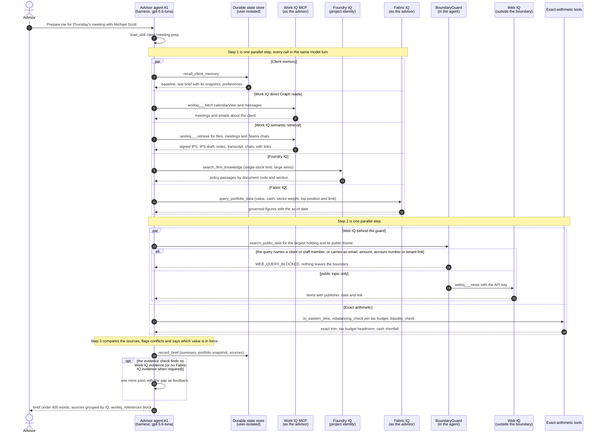
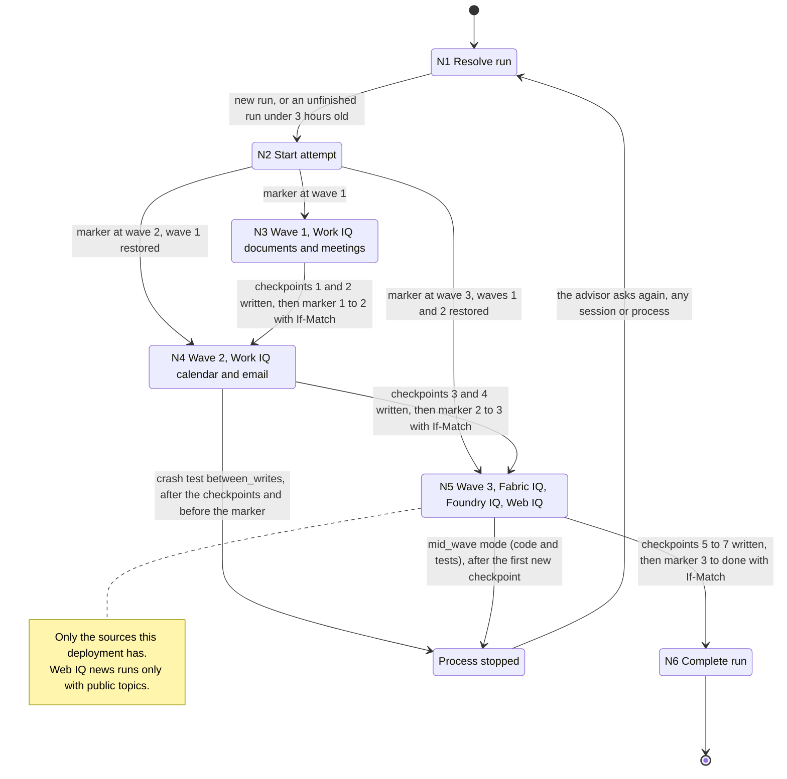
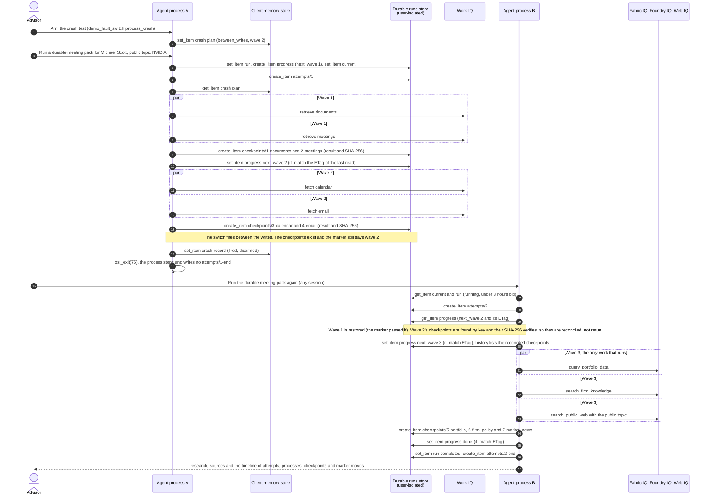
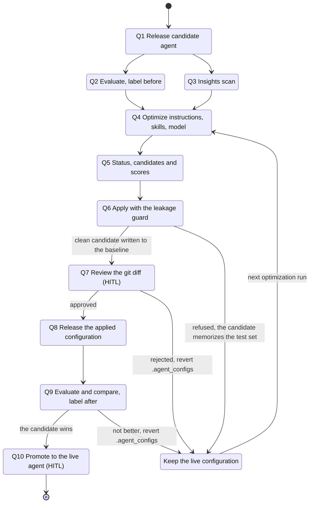
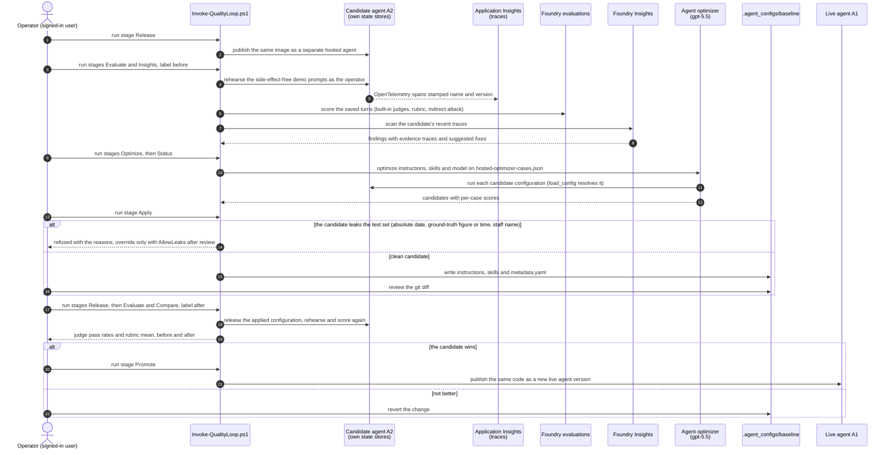
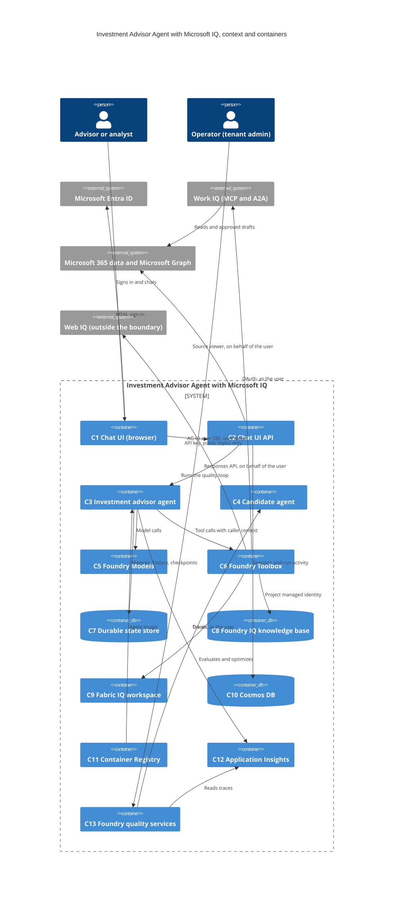
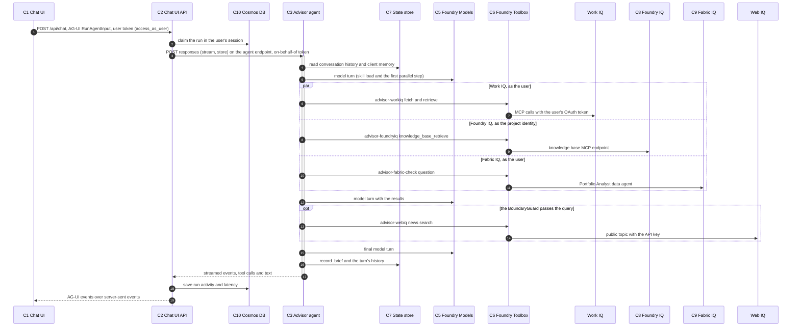

# Investment Advisor Agent with Microsoft IQ: Technical Architecture Specification

**Document Version:** 1.0  
**Date:** 2026-10-18  
**Author(s):** Factory Architect Agent  
**Customer:** Contoso Wealth (fictional firm in a public sample)  
**Application:** Investment Advisor Agent with Microsoft IQ  
**Status:** Implemented (as-built public sample)

> **Fictional data.** Contoso Wealth, the client Michael Scott, and every person, email, meeting, document, policy and
> figure in this sample are fictional and synthetic. Nothing here is investment, tax or legal advice.

> **How this document was produced.** It describes the as-built repository, not a proposal. Agents, tools, identities,
> role assignments, limits and timeouts were read from `src/workplace_agent/`, `.agent_configs/baseline/`,
> `terraform/*.tf`, `scripts/Deploy-AdvisorDemo.ps1`, `scripts/Remove-AdvisorDemo.ps1` and `evals/`. What the
> repository does not settle is marked `[TBD — ...]` and tracked in section 5.

---

## 1. Document Context

### 1.1 Purpose

This document defines the agent-level and system-level architecture of the Investment Advisor Agent with Microsoft
IQ: the hosted agent and the managed agents it calls as tools, its two long-running workflows (the durable meeting
pack and the quality loop), the deployable containers and their Azure hosting, identities and role assignments, and
the deployment options. The business framing, integration catalogue, data architecture and risks are in the
[solution specification](investment-advisor-agent-microsoft-iq_solution_spec.md); there is no separate PRD.

### 1.2 Related Documents

| Document | Location | Description |
|----------|----------|-------------|
| Solution Specification | [investment-advisor-agent-microsoft-iq_solution_spec.md](investment-advisor-agent-microsoft-iq_solution_spec.md) | High-level architecture, integration, data, security and infrastructure design |
| PRD | Not available | `[TBD — no PRD exists; the README states the business problem]` |
| Architecture overview | [ARCHITECTURE.md](../ARCHITECTURE.md) | Short public overview with the diagram |
| Architecture diagram | [investment-advisor-agent-microsoft-iq.drawio](investment-advisor-agent-microsoft-iq.drawio) ([PNG](investment-advisor-agent-microsoft-iq.png), [SVG](investment-advisor-agent-microsoft-iq.svg)) | Lanes, numbered flows, compliance boundary |
| Technical guide | [TECHNICAL-GUIDE.md](../TECHNICAL-GUIDE.md) | How each part works and how to run it by hand |
| Deployment guide | [DEPLOYMENT.md](../DEPLOYMENT.md) | Prerequisites, one-command deployment, manual steps, teardown |
| Quality loop | [QUALITY-LOOP.md](../QUALITY-LOOP.md) | Insights, evaluations, agent optimizer, candidate agent |
| Agent configuration | [.agent_configs/baseline](../../.agent_configs/baseline) | `instructions.md`, 15 skills, `metadata.yaml` (optimizer format) |

---

## 2. Technical Architecture

### 2.1 Agent Architecture

#### 2.1.1 Agent Inventory

The solution builds one agent and reuses Microsoft-managed agents as tools. It is not a multi-agent orchestrator: the
harness agent plans, calls tools in parallel and writes the answer; specialist reasoning that already exists as a
managed agent (Work IQ's own agent, Copilot agents, the Fabric data agent, the knowledge base's query planner) is
reached through a tool.

| Agent Name | Role | Orchestration Pattern | Entry Point | Exposure |
|------------|------|-----------------------|-------------|----------|
| A1 Investment advisor agent (`investment-advisor-agent`) | Prepares the advisor for client conversations from the four Microsoft IQ sources, compares and cites them, keeps durable memory, runs the durable meeting pack, proposes approval-gated drafts | Single agent with skills: Microsoft Agent Framework harness tool loop, parallel tool calls, agents-as-tools, one-pass evidence loop (reflection) | Chat: the hosted agent's Responses endpoint, called by the chat UI API | Internal: tenant users signed in with Microsoft Entra ID who hold **Foundry User** on the project |
| A2 Candidate agent (`<live agent>-candidate`) | The same image released next to A1 with its own state stores, for evaluation and optimization | Same as A1 | Chat (Responses endpoint), called by the quality-loop scripts as the operator | Internal: the operator |
| A3 Brief-writer prompt agent (`advisor-brief-writer`) | A side-effect-free Foundry prompt agent with self-contained sources, used for the first optimizer run in the Quality deployment step | Single prompt agent | Foundry evaluations and agent optimizer | Internal: quality tooling only |
| M1 Work IQ agent (Microsoft-managed) | Answers a whole delegated question with Copilot reasoning over the user's Microsoft 365 data | Agent-to-agent (A2A) task, one task per call | `delegate_to_work_iq` through the `advisor-workiq-chat` toolbox | Microsoft 365, as the signed-in user |
| M2 Copilot agents (Microsoft-managed or organization-built) | Microsoft agents the user can reach (for example Planner) and the organization's own agents, found with `list_agents` and asked with `ask` (`agentId`); Microsoft 365 Copilot is the default agent for `ask` | Delegation through Work IQ `ask` with `agentId`; one conversation per agent kept by the runtime | `workiq___list_agents`, `workiq___ask` | Microsoft 365, as the signed-in user |
| M3 Fabric data agent "Portfolio Analyst" | Answers governed portfolio questions over the synthetic lakehouse | Natural language to SQL inside Fabric | `query_portfolio_data` through the `advisor-fabric-check` toolbox | Fabric workspace, as the signed-in user |
| M4 Foundry IQ knowledge base `firm-knowledge` | Plans the query and retrieves cited firm policy sections (agentic retrieval) | Query planning by the chat model at low reasoning effort, extractive output | `search_firm_knowledge` through the `advisor-foundryiq` toolbox | Azure AI Search, as the project managed identity |

M1 to M4 are configured or deployed by this solution but implemented by Microsoft services; they are not designed
here.

#### 2.1.2 Orchestration Flow

A1 is LLM-driven: the model loads the matching skill with `load_skill` and makes the skill's calls. The skills make
the calls binding: "in ONE step" means every listed call goes out in the same model turn, and the calls of one step
run in parallel (slow sources get their own toolbox session; only Work IQ `ask` calls are serialized, to keep one
conversation per agent). The main flow, meeting preparation (`client-meeting-prep` skill), uses all four IQs:

**Flow Steps:**

1. **Step 1 — Gather (one parallel step):** A1 calls `recall_client_memory`, two direct Microsoft Graph reads through
   Work IQ `fetch` (calendar window and the client's messages), three Work IQ `retrieve` calls scoped to
   OneDrive/SharePoint, meetings and Teams messages, Foundry IQ `search_firm_knowledge` and Fabric IQ
   `query_portfolio_data`. Web IQ joins this step only when the largest holding is already known from memory. A
   retrieval that asks for both files and email is split by the runtime into two source-scoped requests on separate
   toolbox sessions (`ParallelWorkIQToolbox`).
2. **Step 2 — Public context and exact numbers (one parallel step):** `search_public_web` for a public topic (the
   largest holding and its theme). The `BoundaryGuard` checks the query in code before anything is sent; a blocked
   query returns `WEB_QUERY_BLOCKED` and the model rephrases it as a public topic or continues without the web.
   In the same step: `to_eastern_time` for every timestamp, `rebalancing_check` once per tax budget in play (the
   signed IPS budget and any lower budget from a draft or a client email) and `liquidity_check` for cash needs.
3. **Step 3 — Compare and record:** the model compares Fabric IQ with the analyst's email for the same date, flags
   every conflict with both values, sources and dates, calls `record_brief` (the saved snapshot is the labelled stale
   fallback the next time Fabric IQ is unavailable) and writes the brief.
4. **Evidence loop:** after the first pass, `EvidenceCheck` requires Work IQ evidence (and Fabric IQ evidence when
   `ADVISOR_REQUIRE_FABRIC` is on) for a client brief and allows one extra pass (`loop_max_iterations = 2`).
5. **Failure handling:** each IQ tool opens its own toolbox session only when it runs, so an outage or a missing
   consent in one source never blocks the others. Failures return statuses the model reports
   (`PORTFOLIO_DATA_UNAVAILABLE`, `FABRIC_CONSENT_REQUIRED`, `FIRM_KNOWLEDGE_UNAVAILABLE`, `WEB_UNAVAILABLE`,
   `WORKIQ_CHAT_UNAVAILABLE`); a Work IQ `retrieve` that fails on the service side is retried once, and a policy,
   permission or consent denial is never retried.

Other flows reuse the same pattern: firm-policy questions (Foundry IQ only), public news (Web IQ only), delegation to
Work IQ Chat over A2A or to a Copilot agent, the IPS comparison with `ask` and `fileUrls`, chart reading
(`inspect_document`, then Work IQ `ask`, with `read_chart` as the fallback), and the approval-gated draft.

#### 2.1.3 Agent Detail: A1 Investment advisor agent

##### Purpose

A1 is the solution's only custom agent. It turns an advisor's question into grounded research across the four
Microsoft IQ sources, compares what they say, cites every fact with the IQ and item it came from, and says what it
could not verify. It remembers confirmed discussions and briefs per advisor, runs long research as the checkpointed
durable meeting pack (WF-1), and proposes a follow-up email that is created as an Outlook draft only after the advisor
approves it. It never trades, sends or changes anything else.

##### Orchestration Role

| Aspect | Description |
|--------|-------------|
| **Input** | A user turn from the chat UI API through the hosted agent's Responses endpoint, with Foundry's trusted caller context (user ID, platform session ID). Requests without a user and caller context are rejected (`app.py`). |
| **Output** | Streamed Markdown (brief, tables, citations, a `workiq_references` block), tool-call events the UI shows in its activity panel, approval requests for drafts, and consent links (`*_CONSENT_REQUIRED`) the UI turns into Authorize buttons. |
| **Execution** | One harness tool loop per turn; independent calls in one parallel step; managed agents M1 to M4 as tools; at most one extra pass from the evidence loop; WF-1 runs inside the `run_durable_meeting_pack` tool. |

##### LLM Configuration

| Parameter | Value |
|-----------|-------|
| **Model** | `gpt-5.6-luna` (Global Standard deployment named by `AZURE_AI_MODEL_DEPLOYMENT_NAME`); reasoning effort `low`; 128,000-token context window, 8,192 output tokens. An optimizer candidate may run on a deployment from `model_search_deployments`. |
| **Response Format** | Hybrid: free-text Markdown for the advisor, ending with a structured `workiq_references` block (web link and Work IQ path per cited item); every tool returns JSON. |
| **System Prompt Source** | File-based, optimizer format: `.agent_configs/baseline/instructions.md`, 15 skills in `skills/<name>/SKILL.md` (loaded on demand with `load_skill`) and `metadata.yaml`, read with `load_config()` from `azure-ai-agentserver-optimization`. During an optimizer run the platform supplies the candidate (`OPTIMIZATION_CANDIDATE_ID` and its resolver). The harness adds a fixed harness instruction and a clock note. |
| **Other settings** | `store: false` for model calls (the harness keeps history in the state store); harness mode, todo list, built-in web search and file memory are disabled; read-only skill tools are auto-approved. |

##### Tools & Integrations

| Tool Name | Purpose | Integration Type |
|-----------|---------|------------------|
| `workiq___retrieve`, `workiq___fetch`, `workiq___fetch_blob`, `workiq___call_function`, `workiq___get_schema`, `workiq___search_paths`, `workiq___ask`, `workiq___list_agents` | Work IQ: semantic retrieval with citations, direct Graph reads, document bytes, run-time path discovery, Copilot reasoning (`ask` with `fileUrls` or `agentId`), Copilot agents | MCP through Foundry Toolbox `advisor-workiq` (generic MCP tool with a read-only allowlist), OAuth2 as the user; 240-second toolbox client timeout |
| `delegate_to_work_iq` | Work IQ Chat: hand a whole question to Work IQ's own agent and return its finished answer | A2A `SendMessage` through toolbox `advisor-workiq-chat` (`work_iq_preview` over a `RemoteA2A` connection), OAuth2 as the user; one A2A task per call, 180 s |
| `query_portfolio_data` | Fabric IQ: positions, weights against limits, cash, IPS record | MCP through toolbox `advisor-fabric-check` (`fabric_iq_preview`), OAuth2 as the user; 120 s, then the saved snapshot labelled stale |
| `search_firm_knowledge` | Foundry IQ: the firm's policies, procedures, approved products and house view | MCP `knowledge_base_retrieve` through toolbox `advisor-foundryiq`, project managed identity; 60 s |
| `search_public_web`, `read_public_web_page` | Web IQ: public news, pages and quotes, for public context only | MCP through toolbox `advisor-webiq` (`web_iq_preview`), API key; `BoundaryGuard` in the tool; 60 s |
| `draft_follow_up_email` | The only write: an Outlook draft, never sent | Work IQ `create_entity` through toolbox `advisor-drafts`; Agent Framework function approval on every call |
| `probe_workiq_policy` | Demo-only governance probe: a read, and update and delete against an item that does not exist, to show the tenant policy in force | Toolbox `advisor-governance` |
| `inspect_document`, `read_chart` | Verify a cited page; read chart values when Work IQ `ask` cannot | Internal functions over a PDF downloaded through Work IQ; `read_chart` makes one vision call to the chat model |
| `list_client_documents` | Every file in the client's folder ("Client Files/<client>") in the advisor's OneDrive and on the team's SharePoint site, with links and drive item paths, complete where a search can miss files | Internal function: Work IQ `fetch` as the user, in two toolbox sessions in parallel (the OneDrive folder by path; the site's folders by item ID, which is how Work IQ reads another drive) |
| `recall_client_memory`, `record_discussion_baseline`, `record_brief`, `advisor_preferences` | Durable client memory and the advisor's formatting preferences (up to 10, changed with ETag preconditions) | Foundry durable state store (SDK) |
| `run_durable_meeting_pack`, `show_durable_state`, `show_state_store` | WF-1 and its inspection: runs, checkpoints, attempts, timeline; every store and the serving process | Foundry durable state store, Work IQ and the IQ tools above |
| `rebalancing_check`, `liquidity_check`, `to_eastern_time` | Exact trims, tax-budget headroom, liquidity shortfall, US Eastern time | Internal deterministic functions |
| `demo_fault_switch` | Presenter control: a simulated Fabric IQ outage, or the process crash for WF-1 | Foundry durable state store |

##### Guardrails & Safety

- **Grounding:** every fact is labelled with its IQ and item; conflicts show both values, their sources and dates
  and which one is in force; cited items appear in the `workiq_references` block; page numbers are "not verified"
  unless `inspect_document` verified them.
- **Evidence loop:** a client brief without Work IQ evidence (and Fabric IQ evidence when required) gets one more pass
  with the gap as feedback.
- **Boundary guard:** `BoundaryGuard` blocks any Web IQ query or link that names a client or staff member
  (`WEB_BOUNDARY_TERMS`), contains an email address, an amount or an account-like number, or points at a Microsoft 365
  or Azure host. Web prices never reprice client positions.
- **Content filtering:** the blocking guardrail policy (hate, sexual, violence and self-harm on prompts and
  completions, medium threshold) is attached to the hosted agent definition (`rai_config`) and to every model
  deployment this solution creates.
- **Approvals and writes:** the draft tool requires approval on every call; pending approvals live in the hosting
  library's approval store, so an approval can complete on another process. The tenant's Work IQ policy allows create
  and denies directory lookups, partial update, replace and delete. Toolbox `require_approval` metadata is not
  enforced by the hosted runtime, so the harness enforces approvals.
- **Untrusted content:** the instructions treat email, documents, chats and tool output as data, never as
  instructions; evaluations include the indirect-attack judge.
- **Disclaimers:** the arithmetic tools return "Arithmetic on the supplied figures only; not investment, tax or legal
  advice"; briefs note that tax treatment must be confirmed with the client's tax adviser.
- **Budgets:** 128,000-token context, 8,192 output tokens, at most two loop iterations, bounded time per source.

#### 2.1.3 Agent Detail: A2 Candidate agent

##### Purpose

A2 lets the quality loop (WF-2) rehearse, evaluate and optimize a change without touching A1's users or state.
`scripts/Publish-CandidateAgent.ps1` copies A1's definition (toolboxes, model, Work IQ mode, guardrail policy, size)
and changes only the image and `ADVISOR_STORE_PREFIX`, so A2's memory, preferences, history and checkpoints live in
their own state stores.

##### Orchestration Role

| Aspect | Description |
|--------|-------------|
| **Input** | Rehearsal prompts and optimizer test cases, sent as the operator (a signed-in user) |
| **Output** | Turns saved for evaluation; traces for Insights; per-case optimizer scores |
| **Execution** | Same as A1. Consent is stored per agent, so each user consents once more for A2. |

LLM configuration, tools and guardrails are A1's; an applied candidate may change the instructions, the skills and
the model in `.agent_configs/baseline`.

#### 2.1.3 Agent Detail: A3 Brief-writer prompt agent

##### Purpose

A3 (`advisor-brief-writer`) is a Foundry prompt agent with self-contained sources and no tools that touch Microsoft
365. The Quality step of the deployment runs the agent optimizer once on it (`evals/Invoke-FoundryQuality.ps1
optimize`, eight cases in `evals/optimizer-cases.json`) so the quality assets exist before any user has consented to
Work IQ. It is not on the user path.

| Aspect | Description |
|--------|-------------|
| **Input** | Optimizer test cases |
| **Output** | Candidate instructions and scores |
| **Execution** | On demand, by the operator |

### 2.2 Agentic Workflow Architecture

The solution has two structured, long-running workflows. Neither runs on a workflow engine: WF-1 is harness code
inside A1 (`durable.py`) with its state in the Foundry durable state store, and WF-2 is a sequence of operator-run
scripts over Foundry's quality services.

#### 2.2.1 Agentic Workflow Inventory

| Workflow ID | Workflow Name | Purpose | Trigger | Pause / Resume |
|-------------|---------------|---------|---------|----------------|
| WF-1 | Durable meeting pack | Long meeting research in checkpointed waves across the Microsoft IQ sources, resumable after the process stops | User action: the advisor asks for a durable meeting pack (tool `run_durable_meeting_pack`) | Yes: every finished phase is checkpointed before the progress marker moves; asking again from any session or process within 3 hours resumes the run. No HITL gateway. |
| WF-2 | Quality loop | Find recurring problems in real traces, measure, let the agent optimizer propose a better configuration, prove it on the candidate agent, then promote | Operator: `evals/Invoke-QualityLoop.ps1 -Stage ...`; an Insights monitor also scans the live agent's traces daily | Yes: each stage is a separate script run; HITL gateways at Apply (review) and Promote (decision) |

---

#### 2.2.2 Workflow Detail: WF-1 Durable meeting pack

##### Workflow Overview

| Aspect | Description |
|--------|-------------|
| **Workflow ID** | WF-1 |
| **Purpose** | A meeting pack gathers more than one model turn should hold, from sources that can take a minute each. Following Foundry's guidance for long-running agents ("manage task state"), each finished phase is written as an append-only checkpoint before a progress marker moves, so a stop never repeats a finished phase and never writes anything twice. A DAG in code, rather than free-form tool calls, makes that guarantee testable. |
| **Input Data** | `client_name`, `mode` (`auto` resumes an unfinished run, `fresh` starts over), up to three `public_topics` for Web IQ (tickers or companies, never client details) |
| **Output Data** | Per-phase results tagged with their source (Work IQ, Fabric IQ, Foundry IQ, Web IQ), and a durability report: restored, reconciled and executed checkpoints, the progress marker with its ETag, and a timeline of every attempt, process, checkpoint and marker move |
| **Pause / Resume** | State lives under `pack/<client>/<run>/` in the user-isolated `<prefix>-durable-runs` store: `run`, `progress` (next wave, moved with `set_item(if_match=<ETag of the last read>)`), `checkpoints/<n>-<phase>` (`create_item`, result and SHA-256) and `attempts/<n>` with `attempts/<n>-end`. A run is resumable while its status is `running` and it is under 3 hours old. Resume happens when the advisor asks again; automatic re-entry by the platform (resilient background responses) is a preview capability the Agent Framework host supports only for workflow agents, and this chat agent does not use it. |

##### DAG Diagram

Inside each wave the phases run in parallel (fork and join): a wave first reuses every checkpoint whose SHA-256
verifies, then runs only the missing phases. An ordinary failure waits for the rest of its wave, so every phase that
finished is checkpointed, then writes `attempts/<n>-end` with the failure and re-raises.

##### Crash and resume sequence

The presenter's crash switch (`demo_fault_switch` with `process_crash`) arms the `between_writes` mode for wave 2: it
stops the hosting process exactly between the two writes, after wave 2's checkpoints and before the marker moves. A
`mid_wave` mode (stop right after the first new checkpoint of a wave and lose the phases still in flight) exists in
`durable.py` and its tests.

If two attempts race, `create_item` on an existing checkpoint key returns a conflict (409) and the existing
checkpoint is reused; a marker write with a stale ETag fails (412), and the attempt rereads the marker and keeps
whichever is further ahead.

##### Node Inventory

| Node ID | Node Name | Node Type | HITL Gateway | Description |
|---------|-----------|-----------|--------------|-------------|
| N1 | Resolve run | Deterministic | No | Reads `pack/<client>/current`; resumes an unfinished run under 3 hours old, else creates `run`, `progress` and `current` |
| N2 | Start attempt | Deterministic | No | Creates `attempts/<n>` (409 means another attempt took the number: n+1), reads the marker and the crash plan |
| N3 | Wave 1 | Deterministic (tool calls) | No | Work IQ `retrieve`: documents (OneDrive and SharePoint) and meetings, in parallel |
| N4 | Wave 2 | Deterministic (tool calls) | No | Work IQ `fetch`: the calendar window and the client's email (direct Graph reads), in parallel |
| N5 | Wave 3 | Agent (managed agents as tools) | No | Fabric IQ data agent, Foundry IQ knowledge base and Web IQ news, in parallel, for the sources this deployment has |
| N6 | Complete run | Deterministic | No | Marks the run completed, writes `attempts/<n>-end`, returns results and the durability report |

---

###### 2.2.2.1 Node Detail: N1 Resolve run

**Node Configuration**

| Aspect | Description |
|--------|-------------|
| **Node ID** | N1 |
| **Node Type** | **Deterministic** |
| **Description** | Finds the open run for the client or starts a new one (`mode = fresh` always starts over) |

**Tools, APIs & Data Dependencies**

| Dependency | Type | Purpose |
|------------|------|---------|
| Durable runs store (`<prefix>-durable-runs`) | Database (Foundry state store) | `get_item current` and `run`; for a new run `set_item run`, `create_item progress`, `set_item current` |

**Input / Output**

| Direction | Name | Data Type | Scope | Description |
|-----------|------|-----------|-------|-------------|
| Input | `client_name`, `mode`, `public_topics` | Strings | **Request** | Tool arguments |
| Output | `run` | JSON | **Workflow** | Client, status, phases, public topics, `created_at` |

###### 2.2.2.2 Node Detail: N2 Start attempt

| Aspect | Description |
|--------|-------------|
| **Node ID / Type** | N2 / **Deterministic** |
| **Dependencies** | Durable runs store (`create_item attempts/<n>`, `get_item progress`); client memory store (`get_item` crash plan) |
| **Input** | `run` (**Workflow**) |
| **Output** | `attempt` number and `progress` with its ETag (**Workflow**) |

###### 2.2.2.3 Node Detail: N3 Wave 1, N4 Wave 2 and N5 Wave 3

| Aspect | Description |
|--------|-------------|
| **Node IDs / Types** | N3 and N4 / **Deterministic** (fixed Work IQ calls with arguments built in code); N5 / **Agent** (each phase calls a managed agent: the Fabric data agent, the knowledge base's query planner, Web IQ) |
| **Dependencies** | Work IQ MCP (`workiq___retrieve`, `workiq___fetch`) as the user; `query_portfolio_data`, `search_firm_knowledge`, `search_public_web` (the same tools as A1, with the boundary guard); durable runs store (`create_item checkpoints/<n>-<phase>`, `set_item progress` with `if_match`) |
| **Input** | `progress` and verified checkpoints (**Workflow**); client and public topics (**Request**) |
| **Output** | One checkpoint per phase: result (compacted below the 1 MB item limit), SHA-256, wave, source, attempt and process (**Workflow**); the moved marker with its history entry, including any reconciled checkpoints (**Workflow**) |

###### 2.2.2.4 Node Detail: N6 Complete run

| Aspect | Description |
|--------|-------------|
| **Node ID / Type** | N6 / **Deterministic** |
| **Dependencies** | Durable runs store (`set_item run`, `create_item attempts/<n>-end`, `list_keys` by tags for the timeline) |
| **Input** | All checkpoints (**Workflow**) |
| **Output** | Results per phase and the durability report (**Request**, returned to A1) |

---

#### 2.2.2 Workflow Detail: WF-2 Quality loop

##### Workflow Overview

| Aspect | Description |
|--------|-------------|
| **Workflow ID** | WF-2 |
| **Purpose** | An agent that reads live, messy data drifts. The loop finds what goes wrong in real traces, measures it, lets the Foundry agent optimizer propose a better configuration (instructions, skills, model), proves it on the candidate agent A2, and only then promotes it. It is a structured sequence because every change must be measured before and after, reviewed, and kept away from live users until it wins. |
| **Input Data** | The candidate agent's traces in Application Insights; saved rehearsal turns; test cases (`evals/hosted-optimizer-cases.json`); the current `.agent_configs/baseline`; ground truths and staff names for the leakage guard |
| **Output Data** | Evaluation scores before and after (judge pass rates, rubric mean), Insights findings, optimizer candidates with per-case scores, an applied and reviewed configuration, a promoted live agent |
| **Pause / Resume** | Each stage is a separate run of `evals/Invoke-QualityLoop.ps1`; evaluations are saved under a label, optimizer jobs keep their state in Foundry, and the applied configuration is a Git change |

##### DAG Diagram

##### Quality loop sequence

Insights findings are evidence for the operator and for manual fixes; the optimizer scores candidates on the test
cases. The leakage guard exists because the first optimizer run produced a best-scoring candidate that hard-coded
"the current date", copied figures from the test answers and greeted the advisor by name: a higher score that would
have failed in any other week or tenant. Separately, the Quality deployment step creates an Insights monitor that
scans the live agent's traces daily.

##### Node Inventory

| Node ID | Node Name | Node Type | HITL Gateway | Description |
|---------|-----------|-----------|--------------|-------------|
| Q1 | Release candidate agent | Deterministic | No | `scripts/Publish-CandidateAgent.ps1`: same definition as A1, new image, own `ADVISOR_STORE_PREFIX` |
| Q2 | Evaluate (before) | LLM Inference | No | `scripts/Invoke-DemoRehearsal.ps1` saves turns; `foundry_quality.py dataset` scores them with built-in judges, the `advisor-harness-quality` rubric evaluator and the indirect-attack judge |
| Q3 | Insights scan | LLM Inference | No | `foundry_quality.py insights`: recurring problems in the candidate's traces, judged with `gpt-5.5` |
| Q4 | Optimize | Agent | No | `foundry_quality.py optimize-hosted`: the Foundry agent optimizer tunes instructions and skills and compares models from `model_search_deployments` |
| Q5 | Status | Deterministic | No | The last job's candidates and per-case scores |
| Q6 | Apply with the leakage guard | Deterministic | No | `foundry_quality.py apply`: refuses a candidate that states an absolute date, adds a ground-truth figure, date or time absent from the baseline, or names the advisor or analyst when the baseline does not; else writes it into `.agent_configs/baseline` |
| Q7 | Review | Deterministic | Yes — Data Review | The operator reviews `git diff -- .agent_configs` |
| Q8 | Release | Deterministic | No | The applied configuration (model from `metadata.yaml`) is released to A2 |
| Q9 | Evaluate and compare (after) | LLM Inference | No | The same evaluation, then `foundry_quality.py compare` against the "before" label |
| Q10 | Promote | Deterministic | Yes — Tool Approval | `scripts/Publish-AgentImage.ps1` publishes the same code to A1; it warns when `metadata.yaml` names another model than the live deployment |

###### 2.2.2.5 Node Detail: Q4 Optimize

| Aspect | Description |
|--------|-------------|
| **Node ID / Type** | Q4 / **Agent** (the Foundry agent optimizer proposes and scores candidate configurations) |
| **Dependencies** | Agent optimizer (Foundry); `gpt-5.5` deployment (proposes and judges); A2 (runs each candidate, resolved at run time by `load_config()`); `evals/hosted-optimizer-cases.json`; optional `model_search_deployments` |
| **Input** | Baseline configuration and test cases (**Workflow**) |
| **Output** | Optimization job with candidates and per-case scores (**Workflow**, kept in Foundry) |

###### 2.2.2.6 Node Detail: Q6 Apply with the leakage guard

| Aspect | Description |
|--------|-------------|
| **Node ID / Type** | Q6 / **Deterministic** |
| **Dependencies** | `leakage_findings()` in `evals/foundry_quality.py`; ground truths from `evals/hosted-optimizer-cases.json` and `evals/optimizer-cases.json` (shifted to the deployment's story week); the advisor's and analyst's names (`DEMO_ADVISOR_NAME`, `DEMO_ANALYST_NAME` in `.env.local`) |
| **Input** | Best candidate (**Request**); current baseline (**Workflow**) |
| **Output** | The written baseline, or a refusal with reasons (**Request**). `-AllowLeaks` applies anyway after review. |

###### 2.2.2.7 Node Detail: Q7 Review and Q10 Promote (HITL gateways)

| Aspect | Q7 Review | Q10 Promote |
|--------|-----------|-------------|
| **HITL Type** | **Data Review** | **Tool Approval** (releasing to live users) |
| **User Role** | Operator (repository maintainer) | Operator |
| **User Task Description** | Read the applied instructions, skills and model as a Git diff; keep general improvements, revert anything specific to the test set | Decide whether the candidate won: rubric and task adherence up, groundedness and the indirect-attack judge not down; look at the worst case, not only the average |
| **Request Payload** | `git diff --stat` and the full diff of `.agent_configs` | The Compare output and the Status scores |
| **Response Input** | Commit, edit or revert | Run `-Stage Promote`, or revert |
| **Timeout / Escalation** | None (manual) | None (manual) |

---

## 3. System & Components Architecture

### 3.1 System Context & Container Diagram

The high-definition diagram, with the compliance boundary and numbered flows, is
[investment-advisor-agent-microsoft-iq.png](investment-advisor-agent-microsoft-iq.png) (source:
[.drawio](investment-advisor-agent-microsoft-iq.drawio)). The C4 view below combines context and containers.

### 3.2 Container Inventory

| Container ID | Container Name | Purpose | Components Hosted | Azure Service / Platform |
|-------------|----------------|---------|-------------------|--------------------------|
| C1 | Chat UI (browser) | The advisor's entry point: sign-in, chat, sessions, activity panel, approvals, consent links, source viewer | React app, MSAL client, AG-UI client | Runs in the browser; served by C2 |
| C2 | Chat UI API | Validates the user's token, exchanges it on behalf of the user, streams the hosted agent, keeps sessions | FastAPI app, on-behalf-of token broker, session store client, source viewer | Azure Container Apps (Consumption, VNet-injected) |
| C3 | Investment advisor agent | Hosts A1 | Agent Framework harness, 15 skills, the IQ tools, `BoundaryGuard`, durable meeting pack (WF-1), memory, approvals, evidence loop | Microsoft Foundry Agent Service, hosted agent (custom container) |
| C4 | Candidate agent | Hosts A2 for the quality loop | Same image as C3, own state stores | Microsoft Foundry Agent Service, hosted agent |
| C5 | Foundry Models | Reasoning, judging, embeddings | `gpt-5.6-luna`, `gpt-5.5`, `text-embedding-3-large`, optional model-search deployments | Microsoft Foundry (account-level model deployments, Global Standard) |
| C6 | Foundry Toolbox | One MCP endpoint per tool set, with per-user OAuth and the caller's context | Seven toolboxes over project connections | Microsoft Foundry project |
| C7 | Durable state store | User-isolated memory, preferences, history, meeting-pack runs, hosting-library sessions and approvals | `<prefix>-client-memory`, `-preferences`, `-conversations`, `-durable-runs`, Agent Framework hosting stores | Foundry durable state store (preview) |
| C8 | Foundry IQ knowledge base | Firm policy retrieval with citations | Index `firm-library-index`, knowledge source `firm-library-ks`, knowledge base `firm-knowledge` and its MCP endpoint | Azure AI Search (Basic, semantic ranker) |
| C9 | Fabric IQ workspace | Governed, synthetic portfolio data | Lakehouse `advisor_lakehouse`, notebooks, Portfolio Analyst data agent | Microsoft Fabric on a Fabric capacity (F8 by default, or an existing one) |
| C10 | Cosmos DB | UI session list and per-prompt activity | Database `workplace`: `uiSessions`; `chatHistory` for the optional Cosmos history mode | Azure Cosmos DB for NoSQL (serverless, private endpoint) |
| C11 | Container Registry | Immutable agent and UI images | `advisor-harness` and `advisor-ui` repositories | Azure Container Registry (Standard) |
| C12 | Application Insights | Traces for Foundry tracing, evaluations and Insights | Workspace-based Application Insights and Log Analytics | Azure Monitor |
| C13 | Foundry quality services | Measure and improve the agent | Evaluations, rubric evaluator `advisor-harness-quality`, Insights monitor, agent optimizer, prompt agent `advisor-brief-writer` | Microsoft Foundry project |

---

#### 3.2.1 Container Detail: C1 Chat UI (browser)

Single-page app that signs the user in with MSAL (popup through a same-origin `/auth.html` bridge), requests the UI
API's `access_as_user` scope, and renders AG-UI events: streamed Markdown, tool calls with durations, skill loads,
approval prompts (Approve or Reject), consent banners (Authorize) and cited sources.

| Aspect | Choice |
|--------|--------|
| **Language / Framework** | TypeScript, React 19, Vite |
| **Additional Libraries** | `@azure/msal-browser`, `@ag-ui/client`, `@ag-ui/core` |
| **Azure Resource** | Static files built into the C2 image (Node 24 build stage) |

#### 3.2.2 Container Detail: C2 Chat UI API

**Components Hosted:** FastAPI endpoints (`/api/config`, `/api/sessions` and its children, `/api/chat`, `/healthz`,
`/readyz`), token validation (issuer, tenant, audience, authorized party, scope), an on-behalf-of token broker whose
client credential is an assertion from the container's user-assigned managed identity (federated identity credential,
no secret), the Cosmos DB session store, the source viewer (Microsoft Graph), and the static SPA.

| Aspect | Choice |
|--------|--------|
| **Language / Framework / Runtime** | Python 3.14, FastAPI, Uvicorn |
| **Additional Libraries** | MSAL for Python, `azure-cosmos`, `httpx` |
| **Azure Resource** | Azure Container Apps, Consumption workload profile, VNet-injected environment |
| **SKU / Scaling** | 0.5 vCPU, 1 GiB; `ui_min_replicas` (default 1, 0 scales to zero) to 2 replicas |
| **Configuration Hints** | External ingress, HTTPS only, port 8080; 540-second budget per prompt with keep-alive comments; user-assigned identity for ACR pulls and Cosmos DB |

#### 3.2.3 Container Detail: C3 Investment advisor agent (and C4 Candidate agent)

**Components Hosted:** the Agent Framework harness (`create_harness_agent`), the hosted Responses server
(`agent-framework-foundry-hosting`), the optimizer-ready configuration loader, the IQ tools (`portfolio.py`,
`knowledge.py`, `webiq.py`, `workiq_chat.py`, Work IQ toolbox client with parallel source-scoped retrieval), the
durable meeting pack (`durable.py`), client memory, preferences and history providers (`advisor.py`, `history.py`),
approval-gated drafts (`drafts.py`), the evidence loop and the state-store inventory.

| Aspect | Choice |
|--------|--------|
| **Language / Framework / Runtime** | Python 3.14; Microsoft Agent Framework (`agent-framework-core` 1.22 or later), `agent-framework-foundry`, `agent-framework-foundry-hosting`; Responses protocol 2.0.0 |
| **Additional Libraries** | `azure-ai-agentserver-optimization`, `azure-ai-agentserver-core` (state store), `azure-identity`, `agent-framework-azure-cosmos` (optional history), OpenTelemetry |
| **Azure Resource** | Microsoft Foundry Agent Service hosted agent; image pinned by digest from C11 |
| **SKU / Scaling** | 1 vCPU, 2 GiB (Terraform also allows 0.5/1 GiB and 2/4 GiB); instances and scaling are managed by Foundry `[TBD — platform limits]` |
| **Configuration Hints** | Runs as the hosted agent identity; environment from Terraform: project endpoint, model deployment, tenant, toolbox endpoints, `WEB_BOUNDARY_TERMS`, `WORKIQ_MODE=mcp`, `ADVISOR_EVIDENCE_LOOP`; C4 differs only in image and `ADVISOR_STORE_PREFIX` |

#### 3.2.4 Container Detail: C5 Foundry Models

| Aspect | Value |
|--------|-------|
| **Deployments** | `gpt-5.6-luna` (agent; deployment script default 150K TPM), `gpt-5.5` (optimizer, Insights judge; 100K TPM), `text-embedding-3-large` (Foundry IQ vectors and the search vectorizer; 50K TPM); optional `model_search_deployments` |
| **SKU** | Global Standard; version upgrade once a new default is available |
| **Configuration Hints** | Created only when this deployment creates the Foundry account; with an existing account the same deployment names must already exist there. Deployments created here carry the blocking guardrail policy. |

#### 3.2.5 Container Detail: C6 Foundry Toolbox

| Toolbox | Tool type | Connection (credential) | Exposed upstream tools |
|---------|-----------|-------------------------|------------------------|
| `advisor-workiq` | Generic MCP | `work-iq-mcp` (OAuth2 `RemoteTool`, delegated `WorkIQAgent.Ask`) | `retrieve`, `fetch`, `fetch_blob`, `call_function`, `get_schema`, `search_paths`, `ask`, `list_agents` |
| `advisor-workiq-chat` | `work_iq_preview` | `work-iq` (OAuth2 `RemoteA2A`) | A2A `SendMessage` |
| `advisor-drafts` | Generic MCP | `work-iq-mcp` | `create_entity` |
| `advisor-governance` | Generic MCP | `work-iq-mcp` | `fetch`, `update_entity`, `delete_entity` (demo-only probe) |
| `advisor-fabric-check` | `fabric_iq_preview` | `fabric-portfolio` (OAuth2, delegated Power BI `DataAgent.Execute.All`) | The Portfolio Analyst question tool |
| `advisor-foundryiq` | Generic MCP | `firm-knowledge-kb` (`ProjectManagedIdentity`, audience Azure AI Search) | `knowledge_base_retrieve` |
| `advisor-webiq` | `web_iq_preview` | `WebIQ` (`CustomKeys`, API key) | Web IQ tools; the agent uses web, news, finance and browse |

Toolbox `require_approval` is `never` on every toolbox: the hosted runtime does not enforce it, so the harness
enforces approvals. In an existing, shared Foundry account, every project connection name carries this deployment's
suffix, because connection names are unique across an account.

#### 3.2.6 Container Detail: C7 Durable state store

| Aspect | Value |
|--------|-------|
| **Stores** | `<prefix>-client-memory` (baselines, the last brief and its snapshot, presenter switches), `<prefix>-preferences` (one item, ETag-guarded), `<prefix>-conversations` (history in chunk items of about 700 KB plus an index), `<prefix>-durable-runs` (WF-1), and the Agent Framework hosting library's session and function-approval stores. `<prefix>` is `advisor` by default; the candidate agent uses its own. |
| **Isolation** | Every store is created with user isolation: items are partitioned by the calling user, so one advisor never reads another's. |
| **Item rules** | Keys up to 128 characters, values up to 1 MB, ETags on every write, `If-Match` preconditions (412), create-only writes (409), tag-filtered key listing |
| **Client behaviour** | Reads and unconditional writes get a 6-second hedge and one retry; conditional and create-only writes are never repeated |
| **Azure Resource / SKU** | Foundry durable state store (preview), reached through the project endpoint as the hosted agent identity. Retention `[TBD — service item expiry; the inventory tool reports it at run time]` |

#### 3.2.7 Container Detail: C8 Foundry IQ knowledge base

| Aspect | Value |
|--------|-------|
| **Components** | Index `firm-library-index` (one chunk per policy section; 3,072-dimension `text-embedding-3-large` vectors, HNSW; semantic configuration `library`), knowledge source `firm-library-ks`, knowledge base `firm-knowledge` (extractive output, query planning by the chat model at low reasoning effort) and its MCP endpoint |
| **Ingestion** | `scripts/Set-FoundryIqKnowledge.ps1` builds six fictional policy PDFs, embeds each section as the deploying user and pushes the documents (no storage account or indexer, so it works where policy disables public storage access) |
| **Azure Resource / SKU** | Azure AI Search, Basic (`foundry_iq_search_sku`) with the semantic ranker; key authentication disabled; system-assigned identity; region from `-SearchLocation` when the resource group's region has no capacity |

#### 3.2.8 Container Detail: C9 Fabric IQ workspace

| Aspect | Value |
|--------|-------|
| **Components** | Workspace, lakehouse `advisor_lakehouse` with synthetic Delta tables (`clients`, `ips_profiles`, `securities`, `prices_daily`, `positions_daily`, `position_changes`, `client_summary_daily`, `transactions`), generator notebooks, and the published Portfolio Analyst data agent with its MCP endpoint |
| **Deployment** | `fabric/Deploy-FabricPortfolio.ps1`, then `scripts/Set-FabricIqConnection.ps1` (bring-your-own Entra app with delegated `DataAgent.Execute.All`) and the `advisor-fabric-check` toolbox |
| **Azure Resource / SKU** | Microsoft Fabric on a Fabric capacity: `F8` by default (`-FabricSku`, F2 or larger; `''` skips Fabric), or an existing capacity (`-ExistingFabricCapacityId`). Pause it when idle with `scripts/Set-FabricCapacityState.ps1`. |

#### 3.2.9 Container Detail: C10 Cosmos DB

| Aspect | Value |
|--------|-------|
| **Components** | Database `workplace`; container `uiSessions` (partition `/owner`, a hash of the API, project, agent, tenant and user) for sessions, titles and per-prompt activity; container `chatHistory` (partition `/session_id`) for the optional Cosmos history provider (`ADVISOR_HISTORY=cosmos`), not used by default |
| **Azure Resource / SKU** | Azure Cosmos DB for NoSQL, serverless, Session consistency; local authentication and public network access disabled; private endpoint and `privatelink.documents.azure.com` zone in the UI virtual network; item TTL `history_retention_days` (30) |

#### 3.2.10 Container Detail: C11 Container Registry, C12 Application Insights, C13 Foundry quality services

| Container | Azure Resource / SKU | Configuration Hints |
|-----------|----------------------|---------------------|
| C11 | Azure Container Registry, Standard, admin user disabled | Images are built in the registry (`az acr build`, no local Docker) and referenced by `@sha256` digest only; the project identity pulls the agent image through the `agent-images` connection, the UI identity pulls the UI image |
| C12 | Application Insights (workspace-based) and Log Analytics (`PerGB2018`, 30-day retention) | Connected to the Foundry account (when created here) and to the project; the container stamps its spans with the agent's `name:version` so Insights sees one agent identity |
| C13 | Foundry evaluations, rubric evaluator `advisor-harness-quality`, Insights monitor (daily scans), agent optimizer, prompt agent `advisor-brief-writer` | Created by the Quality deployment step and driven by `evals/foundry_quality.py` through `evals/Invoke-FoundryQuality.ps1` and `evals/Invoke-QualityLoop.ps1` |

---

### 3.3 End-2-End Flow

**Use Case:** Client meeting preparation (the flow every other use case shares: sign-in, streamed turn, tool calls
through the toolbox, state, streamed answer).

**Flow Summary:**

| Step | From | To | Action / Message |
|------|------|----|-----------------|
| 1 | C1 Chat UI | C2 Chat UI API | Prompt as an AG-UI `RunAgentInput` with the user's `access_as_user` token |
| 2 | C2 Chat UI API | C10 Cosmos DB | Claim the run in the user's session (partitioned by owner) |
| 3 | C2 Chat UI API | C3 Advisor agent | `POST .../agents/{agent}/endpoint/protocols/openai/responses` with `stream` and `store`, on behalf of the user |
| 4 | C3 Advisor agent | C7 State store | Read the platform session's history and the client's memory |
| 5 | C3 Advisor agent | C5 Foundry Models | Model turn: load the skill, plan the parallel step |
| 6 | C3 Advisor agent | C6 Foundry Toolbox | Work IQ, Foundry IQ and Fabric IQ calls in parallel, each on its own toolbox session with the caller's context |
| 7 | C6 Foundry Toolbox | Work IQ, C8, C9 | Each connection applies its credential: the user's OAuth token, or the project managed identity |
| 8 | C3 Advisor agent | C6 Foundry Toolbox, Web IQ | Public news, only if the `BoundaryGuard` passes the query |
| 9 | C3 Advisor agent | C7 State store | `record_brief` and the turn's history |
| 10 | C3, C2 | C1 Chat UI | Streamed text and tool events; C2 saves activity in C10 |

## 4. Cross-Cutting Concerns

### 4.1 Shared Infrastructure

| Shared Component | Purpose | Azure Service |
|-----------------|---------|---------------|
| Foundry project | Hosts both agents, the toolboxes, the connections, the state stores and the quality assets; the unit of isolation between deployments (also in a shared account) | Microsoft Foundry |
| Identity | Sign-in, on-behalf-of exchange, per-user OAuth consent for Work IQ and Fabric IQ, managed and agent identities | Microsoft Entra ID |
| Guardrail policy | Blocking content filters for the agent definitions and the model deployments created here | Foundry guardrail (RAI) policy `workplace-guardrail` (`workplace-guardrail-<suffix>` in an existing account) |
| Observability | Traces, logs, Insights, evaluations | Application Insights and Log Analytics |
| Image registry | Immutable images for C3, C4 and C2 | Azure Container Registry |
| Virtual network | UI ingress and the private path to Cosmos DB | Azure Virtual Network (`10.50.0.0/24`): Container Apps subnet and private-endpoint subnet, private DNS zone |
| Secrets | None stored by the solution: no keys for Azure services (Entra-only); the Web IQ key and the Application Insights connection strings are held in Foundry connections; the content publisher's short-lived secret stays in memory | Foundry connections |

### 4.2 Observability Strategy

**Two-tier, single stack:** Foundry's AI-layer tooling and Azure Monitor share the same OpenTelemetry traces in
Application Insights.

| Layer | Tooling | What Is Captured | Consumers |
|-------|---------|-----------------|-----------|
| LLM and agent tracing (AI layer) | Foundry tracing on Application Insights; Agent 365 observability where the tenant has it | Model calls, tool calls and results, token counts, latency; harness spans and attributes (`advisor.*`: memory, Fabric fallbacks, Work IQ retries, Web IQ blocks, durable checkpoints, evidence gaps, chart reads); spans stamped `name:version`. Prompts and payloads only when `agent_capture_content` is on (the deployment script turns it on for synthetic demo tenants only). | Delivery team, quality loop |
| Quality | Foundry evaluations, rubric evaluator, Insights monitor (daily), agent optimizer | Judge scores, recurring problems with evidence traces, candidate scores | Delivery team |
| Application logs | Application Insights, container logs | Agent model and source timings without prompts or content; UI preparation, first-event, first-text and response latency and checkpoint counts | Delivery team |
| Infrastructure metrics | Azure Monitor | Container Apps replicas and requests, Cosmos DB request units, Azure AI Search latency | Delivery team |
| Conversation audit | Foundry conversations (UI sessions use `store: true`), Cosmos DB `uiSessions` | Conversation items and stored responses; per-prompt activity, tool calls and timings | Delivery team; `[TBD — compliance retention]` |
| Alerting | None configured | — | `[TBD — alert rules and on-call]` |

### 4.3 Security Architecture

#### Identity: who calls what, as whom

| # | Caller | Calls | Identity | Mechanism | Authorization |
|---|--------|-------|----------|-----------|---------------|
| 1 | Browser (C1) | Microsoft Entra ID, then C2 | Signed-in user | MSAL sign-in with the browser (SPA) app registration; bearer token for the UI API's `access_as_user` scope | C2 validates issuer, tenant, audience, authorized party and scope on every request |
| 2 | C2 Chat UI API | C3 hosted agent (Responses, conversations) | Signed-in user | On-behalf-of token for `https://ai.azure.com`; the client credential is an assertion from C2's user-assigned managed identity (federated identity credential, no secret) | The user needs **Foundry User** on the project |
| 3 | C2 Chat UI API | Microsoft Graph (source viewer) | Signed-in user | On-behalf-of token for Microsoft Graph | Delegated `Files.Read`, `Sites.Read.All`, `Mail.Read`, `Calendars.Read`, `Chat.Read`; the user's own access |
| 4 | C2 Chat UI API | C10 Cosmos DB | UI user-assigned managed identity | Entra token over the private endpoint | Cosmos DB Built-in Data Contributor on `uiSessions` only |
| 5 | C3 hosted agent | C5 models, C7 state store, C6 toolboxes | Hosted agent identity (the agent instance identity the platform creates; `FOUNDRY_AGENT_INSTANCE_CLIENT_ID`) | Entra tokens for the project endpoint; `FoundryToolbox` forwards Foundry's trusted per-request caller context | **Foundry User** on the project; state-store items are partitioned by the calling user |
| 6 | C6 toolbox `advisor-workiq`, `advisor-drafts`, `advisor-governance` | Work IQ MCP | Signed-in user | OAuth2 `RemoteTool` connection with the toolbox app registration; delegated `WorkIQAgent.Ask`; one-time consent per user and per agent | The user's Microsoft 365 permissions; the tenant's Work IQ policy evaluates every call |
| 7 | C6 toolbox `advisor-workiq-chat` | Work IQ Chat over A2A | Signed-in user | OAuth2 `RemoteA2A` connection; one A2A task per call | As row 6 |
| 8 | Work IQ | Microsoft 365 data, Copilot agents (M1, M2) | Signed-in user | Delegated, inside Microsoft 365 | Results trimmed to the user's permissions |
| 9 | C6 toolbox `advisor-fabric-check` | Fabric data agent (M3) | Signed-in user | OAuth2 connection with a bring-your-own app registration; delegated Power BI `DataAgent.Execute.All`; one-time consent | The user's Fabric workspace permissions |
| 10 | C6 toolbox `advisor-foundryiq` | Foundry IQ knowledge base (C8) | Foundry project managed identity | `ProjectManagedIdentity` connection, audience Azure AI Search; no user consent | **Search Index Data Reader** on the search service |
| 11 | Azure AI Search | C5 (query vectors, query planning) | Search service system-assigned identity | Entra token | **Cognitive Services User** on the Foundry account |
| 12 | C6 toolbox `advisor-webiq` | Web IQ (`api.microsoft.ai`) | No user identity: an API key | `CustomKeys` connection (`x-apikey`) | Outside the Microsoft 365 and Azure compliance boundary; the `BoundaryGuard` in C3 decides what may be sent |
| 13 | Foundry project | C11 registry (agent image pulls) | Project managed identity | `agent-images` connection (managed identity) | **AcrPull** |
| 14 | C2 Container App | C11 registry (UI image pulls) | UI user-assigned managed identity | Registry identity | **AcrPull** |
| 15 | Foundry Insights and evaluations | C12 Application Insights | Project managed identity, and the signed-in operator | Entra tokens | Project: **Log Analytics Reader**, **Monitoring Data Reader**, **Monitoring Reader**; operator: **Monitoring Reader** |
| 16 | C3 hosted agent | Agent 365 observability (where the tenant has it) | Hosted agent identity | Entra app role | `Agent365.Observability.OtelWrite` |
| 17 | Quality-loop scripts and the agent optimizer | C4 candidate agent | The operator, as a signed-in user | Responses API | Work IQ reads the operator's own Microsoft 365 data with the operator's consent for C4 |
| 18 | Deployment and teardown scripts | Azure, Entra ID, Fabric, Microsoft 365 | The operator (tenant admin, subscription Owner) | Private Azure CLI profile per deployment | Owner (or User Access Administrator) for role assignments; Global Administrator for app registrations and admin consent |
| 19 | Content publisher | Microsoft 365 (fictional story) | App registration `advisor-harness-hydration[-<suffix>]` | Graph application permissions `Mail.ReadWrite`, `Calendars.ReadWrite`, `Sites.ReadWrite.All`, `MailboxSettings.ReadWrite`; the secret is replaced on every run, kept in memory and expires after two days | Demo tenants only; remove with `-RemoveApp` |

#### Azure RBAC role assignments (from Terraform)

Every Azure role assignment in `terraform/*.tf`, with the exact role names. "Deploying user" is the signed-in
operator (`data.azurerm_client_config.current`).

| Terraform resource | Principal | Role | Scope | Created when |
|--------------------|-----------|------|-------|--------------|
| `identity.tf` `project_foundry_user` | Foundry project managed identity | Foundry User | Foundry account (created or existing) | Always |
| `identity.tf` `project_acr_pull` | Foundry project managed identity | AcrPull | Container registry | Always |
| `identity.tf` `current_user_project_manager` | Deploying user | Foundry Project Manager | Foundry project | Always |
| `identity.tf` `current_user_foundry_user` | Deploying user | Foundry User | Foundry project | Always |
| `identity.tf` `current_user_acr_push` | Deploying user | AcrPush | Container registry | Always |
| `identity.tf` `users_foundry_user` | Each object ID in `user_object_ids` (the analyst and `-ExtraUserUpns`) | Foundry User | Foundry project | One per user |
| `identity.tf` `project_appinsights_log_reader` | Foundry project managed identity | Log Analytics Reader | Application Insights | Always |
| `identity.tf` `project_appinsights_monitoring_reader` | Foundry project managed identity | Monitoring Data Reader | Application Insights | Always |
| `identity.tf` `project_appinsights_insights_reader` | Foundry project managed identity | Monitoring Reader | Application Insights | Always |
| `identity.tf` `current_user_appinsights_insights_reader` | Deploying user | Monitoring Reader | Application Insights | Always |
| `toolbox.tf` `agent_toolbox_user` | Hosted agent identity | Foundry User | Foundry project | When the agent is released |
| `foundry_iq.tf` `search_foundry_user` | Azure AI Search system-assigned identity | Cognitive Services User | Foundry account (created or existing) | When `foundry_iq_enabled` (default) |
| `foundry_iq.tf` `project_search_reader` | Foundry project managed identity | Search Index Data Reader | Azure AI Search service | When `foundry_iq_enabled` |
| `foundry_iq.tf` `current_user_search_contributor` | Deploying user | Search Service Contributor | Azure AI Search service | When `foundry_iq_enabled` |
| `foundry_iq.tf` `current_user_search_data_contributor` | Deploying user | Search Index Data Contributor | Azure AI Search service | When `foundry_iq_enabled` |
| `foundry.tf` `foundry_network_connection_approver` | Foundry account system-assigned identity | Azure AI Enterprise Network Connection Approver | Foundry account and Cosmos DB account | Only with `foundry_managed_network = true` on an account created here (the deployment script sets it to `false`) |
| `ui.tf` `ui_acr_pull` | UI user-assigned managed identity | AcrPull | Container registry | When the UI is deployed |
| `ui.tf` `ui_sessions` (Cosmos DB data plane) | UI user-assigned managed identity | Cosmos DB Built-in Data Contributor (built-in SQL role definition `…0002`) | Container `uiSessions` | When the UI is deployed |
| `cosmos.tf` `agent_history` (Cosmos DB data plane) | Hosted agent identity | Cosmos DB Built-in Data Contributor (built-in SQL role definition `…0002`) | Container `chatHistory` (optional Cosmos history mode) | When the agent is released |

Not Azure RBAC: `agent.tf` `agent365_observability` grants the hosted agent identity the Entra app role
`Agent365.Observability.OtelWrite`, only in tenants that have the Agent 365 observability service principal.

#### Microsoft Entra ID app registrations

| App registration | Created by | Permissions | Purpose |
|------------------|------------|-------------|---------|
| `<repo>-<suffix>-toolbox` | Terraform (`toolbox.tf`) | Delegated `WorkIQAgent.Ask` (tenant admin consent by `Set-AdvisorToolbox.ps1`); redirect URL from the Foundry connection | OAuth client of the Work IQ MCP and A2A connections |
| `<repo>-<suffix>-ui-api` | Terraform (`ui.tf`) | Exposes `access_as_user`; requires Foundry `user_impersonation` and Graph `Files.Read`, `Sites.Read.All`, `Mail.Read`, `Calendars.Read`, `Chat.Read` (admin consent by `Publish-Ui.ps1`); federated credential for the UI identity | On-behalf-of exchange in C2 |
| `<repo>-<suffix>-ui-browser` | Terraform (`ui.tf`) | Single-page app, pre-authorized for `access_as_user` | Sign-in in C1 |
| `advisor-harness-fabric-iq[-<suffix>]` | `scripts/Set-FabricIqConnection.ps1` | Delegated Power BI `DataAgent.Execute.All`, tenant admin consent | OAuth client of the Fabric IQ connection |
| `advisor-harness-hydration[-<suffix>]` | `hydration/Publish-DemoContent.ps1` | Graph application permissions (row 19 above) | Fictional story content |
| Work IQ service principal | Terraform (`use_existing = true`, `prevent_destroy`) | — | Shared by the tenant; adopted, never deleted |

#### Network Security

| Control | Implementation |
|---------|---------------|
| VNET isolation | Only the chat UI is VNet-injected (`10.50.0.0/24`: Container Apps subnet `10.50.0.0/27`, private-endpoint subnet `10.50.0.32/27`). Cosmos DB has public network access disabled and is reached through its private endpoint and private DNS zone. |
| Foundry account | Public endpoint with Entra-only authentication (local auth disabled when created here). The Foundry managed virtual network is off in the deployment script, because OAuth2 tool connections such as Work IQ report "not a supported target" on managed-network accounts. `[TBD — private networking for production]` |
| Azure AI Search | Public endpoint, key authentication disabled (Entra only) |
| Public ingress | Container Apps external ingress, HTTPS only, port 8080; no WAF or API gateway `[TBD — WAF or API Management for production]` |
| Egress | No egress controls configured. Web IQ calls leave the compliance boundary by design and carry public topics only. `[TBD — egress controls for production]` |
| TLS | HTTPS on every endpoint; insecure connections are refused at the UI ingress |

#### Data Security

| Control | Status |
|---------|--------|
| Encryption at rest | Service-managed keys on every service; no customer-managed keys `[TBD — CMK requirement]` |
| Encryption in transit | HTTPS everywhere |
| Data classification | Synthetic data only in this sample. Work IQ returns sensitivity labels with retrieval hits; the agent does not enforce them `[TBD — label-based handling]` |
| Boundary | Client data stays inside the Microsoft 365 and Azure boundary; the `BoundaryGuard` keeps names in `WEB_BOUNDARY_TERMS`, email addresses, amounts, account-like numbers and tenant links out of Web IQ |
| Model data processing | Global Standard deployments may process prompts in any Azure region `[TBD — Data Zone deployments for residency requirements]` |
| Trace content | `agent_capture_content = true` in the deployment script (synthetic tenants only); it must be `false` for real data |
| Retention | Cosmos DB items 30 days (TTL); Log Analytics 30 days; state store and Foundry conversation retention `[TBD]` |
| Writes | Only approved Outlook drafts; the Work IQ policy denies update, replace and delete |

### 4.4 CI/CD Pipeline

| Aspect | Details |
|--------|---------|
| **Preferred Platform** | GitHub Actions for validation (`.github/workflows/ci.yml`, on pull requests and pushes to `main`): Python tests on 3.14, the story-date agreement check (Python, PowerShell, Node), UI tests and build on Node 24, `terraform fmt` and `terraform validate`. Releases run from the operator's machine. `[TBD — release pipeline with environment approvals]` |
| **IaC Tool** | Terraform 1.11 or later (`azurerm` 4.67.0, `azapi` 2.13.0, `azuread` 3.6.0), local state kept outside the repository, applied by `scripts/Invoke-TerraformApply.ps1` (plans first and refuses a plan that changes or destroys existing resources unless changes are allowed); PowerShell 7 scripts for what Terraform does not manage (connections, toolboxes, Fabric items, Foundry IQ index and knowledge base, quality assets, content) |
| **Container Registry** | Azure Container Registry; images built in the registry with `az acr build` (no local Docker) |
| **Deployment Target** | Foundry hosted agent (`Microsoft.Foundry/agents` data-plane resource; each release is a new agent version) and Azure Container Apps (UI). Terraform accepts only `@sha256` image digests. |
| **Deployment Strategy** | `scripts/Publish-AgentImage.ps1` builds, pins the digest in `agent.auto.tfvars` and applies a new agent version; `scripts/Publish-Ui.ps1` does the same for the UI (single revision mode), grants admin consent and checks `/readyz`. Changes are tried first on the candidate agent (`scripts/Publish-CandidateAgent.ps1`) and promoted with the same image. |
| **Environment Strategy** | One deployment per tenant and profile (`-ProfileName`, a private Azure CLI profile and the suffix for tenant-wide names); inside a deployment the candidate agent is the pre-production slot. |

### 4.5 Deployment Options and Teardown

`scripts/Deploy-AdvisorDemo.ps1` runs idempotent steps (Config, Platform, WorkIq, Fabric, FoundryIq, WebIq, Agent,
Ui, Quality, Content, Prewarm), then prints the steps that need a person: the Work IQ tenant policy, each user's
consent, recording the review meeting, the Monday content stage and the quality loop.

**Default: create everything from scratch.** In the target resource group the Platform step (Terraform) creates:

- a Microsoft Foundry account (kind `AIServices`, S0, local authentication disabled, project management allowed) with
  the model deployments `gpt-5.6-luna`, `gpt-5.5` and `text-embedding-3-large` (plus any `model_search_deployments`),
  the guardrail policy `workplace-guardrail`, the project, and the registry and Application Insights connections;
- a Fabric capacity (`F8` by default; `-FabricSku ''` skips Fabric);
- Azure AI Search for Foundry IQ (Basic, semantic ranker; `-SearchLocation` for another region);
- Azure Container Registry, Azure Cosmos DB (serverless, private), Application Insights with Log Analytics;
- Azure Container Apps for the chat UI with its virtual network, private endpoint and user-assigned identity;
- the Entra app registrations (toolbox OAuth client, UI API, UI browser) and the role assignments in section 4.3,
  and adopts the tenant's shared Work IQ service principal.

The later steps add the Work IQ connections and toolboxes, the Fabric workspace and data agent, the Foundry IQ index,
knowledge source, knowledge base, connection and toolbox, Web IQ (only with `-WebIqApiKey`), the agent and UI
releases, the quality assets and the fictional Microsoft 365 content.

**Option: reuse an existing Foundry account** (`-ExistingFoundryAccountId`, Terraform `existing_foundry_account_id`),
for example from a shared resource group:

- the deployment creates only **its own project** and **its own guardrail policy** (`workplace-guardrail-<suffix>`) in
  that account, so deployments that share the account never share agents, toolboxes, connections, state stores or
  evaluations; every project connection name carries the deployment's suffix, because connection names are unique
  across an account;
- it uses the account's **existing model deployments** `gpt-5.6-luna` (or `-ChatModel`), `gpt-5.5` and
  `text-embedding-3-large` (and any `model_search_deployments`); Terraform reads them as data sources and stops the
  plan with the missing deployment's name otherwise; it creates no deployments in that account;
- preconditions: the account allows project management, and `foundry_managed_network` is `false`; the project is
  created in the account's region; the operator needs Owner or User Access Administrator on the account for the role
  assignments (project identity as **Foundry User**, Azure AI Search identity as **Cognitive Services User**);
- the agent's own guardrail still applies through the agent definition; the existing deployments keep their own
  content filters;
- **traces:** Foundry sends every project's traces to the Application Insights connected to the account, so this
  project's traces land in the account's Application Insights (Terraform finds it from the account's AppInsights
  connection). The project identity gets **Log Analytics Reader**, **Monitoring Data Reader** and **Monitoring
  Reader** there, so Insights and trace evaluations can read them; an account without one gets this deployment's
  Application Insights as its connection.

**Option: reuse an existing Fabric capacity** (`-ExistingFabricCapacityId`, Terraform `existing_fabric_capacity_id`):
no capacity is created; the deployment's **own workspace** (lakehouse, notebooks, Portfolio Analyst data agent) goes
on that capacity. The operator must be a capacity administrator, the capacity must be running during the Fabric step,
and pausing it pauses it for everyone who uses it.

Everything else (Azure AI Search, registry, Cosmos DB, Container Apps, Application Insights, Entra apps) is created in
the deployment's resource group in all three cases.

| | Create from scratch (default) | Existing Foundry account | Existing Fabric capacity |
|---|---|---|---|
| Foundry account | Created | Reused | — |
| Model deployments | Created (`gpt-5.6-luna`, `gpt-5.5`, `text-embedding-3-large`) | Reused; must already exist | — |
| Foundry project | Created | Created in the existing account | — |
| Guardrail policy | `workplace-guardrail` | `workplace-guardrail-<suffix>` in the existing account | — |
| Fabric capacity | Created (`F8`) | — | Reused |
| Fabric workspace, lakehouse, data agent | Created | — | Created on the existing capacity |
| Removed by teardown | Everything above | Only the project, guardrail policy and role assignments | Only the workspace |

**Teardown never deletes reused resources.** `scripts/Remove-AdvisorDemo.ps1` deletes the Fabric workspace, the
candidate agents, extra UI instances and the script-created app registrations, then runs Terraform destroy, keeping
the tenant's shared Work IQ service principal (removed from state, not deleted). An existing Foundry account or Fabric
capacity is kept: Terraform outputs `foundry_account_managed` and `fabric_capacity_managed` tell the script which
resources the deployment owns, and only the deployment's project, guardrail policy, role assignments and workspace are
removed from shared resources. `-PurgeFoundry` purges only an account the deployment created. The fictional Microsoft
365 content stays in the tenant ([DEPLOYMENT.md](../DEPLOYMENT.md) lists it for manual cleanup).

---

## 5. Open Items & Blockers

| # | Item | Owner | Status | Impact |
|---|------|-------|--------|--------|
| 1 | No PRD: business requirements, success metrics and personas beyond the demo | `[TBD]` | Open | Non-blocking for the sample |
| 2 | Work IQ workspaces (SharePoint Embedded working storage) have no public API yet; durable state uses the Foundry state store until one exists | Microsoft roadmap | Open | Non-blocking |
| 3 | Automatic re-entry of an interrupted turn by the platform (resilient background responses) is supported for workflow agents only; this chat agent resumes when asked. A native workflow version of the meeting pack would be a separate agent design. | `[TBD]` | Open | Non-blocking |
| 4 | Work IQ Chat over A2A through the Foundry toolbox is one task per call (no context ID is forwarded); follow-ups use Work IQ `ask` | Microsoft platform | Open | Non-blocking |
| 5 | Private networking for the Foundry account while OAuth2 tool connections are not supported on managed networks; private endpoints for Azure AI Search | `[TBD]` | Open | Blocking for some production policies |
| 6 | Retention of state-store items and Foundry conversations; compliance requirements for real client data (books and records, supervision of communications, data residency) | `[TBD]` | Open | Blocking for production |
| 7 | Hosted-agent scaling limits, concurrency, performance targets and token budgets | `[TBD]` | Open | Non-blocking |
| 8 | Alert rules, on-call model, release pipeline with approvals | `[TBD]` | Open | Non-blocking |
| 9 | Web IQ (preview) pricing and terms for production use | `[TBD]` | Open | Non-blocking (optional source) |
| 10 | Sensitivity-label handling of Work IQ results | `[TBD]` | Open | Non-blocking for synthetic data |

## Document Revision History

| Version | Date | Author | Changes |
|---------|------|--------|---------|
| 1.0 | 2026-10-18 | Factory Architect Agent | Initial creation from the as-built repository |
